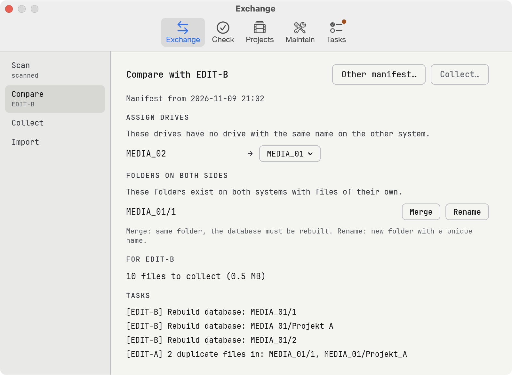
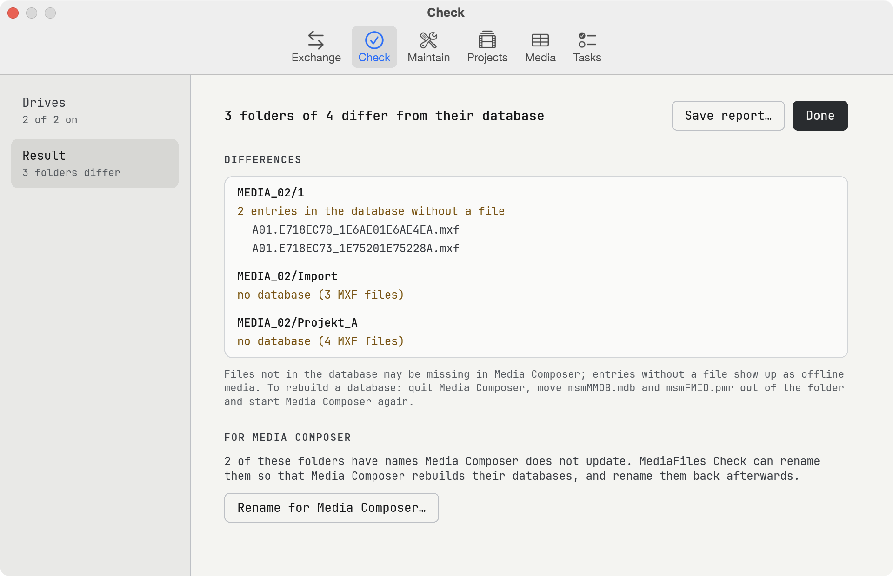

# MediaFiles Check

Looks after the Avid media files (MXF) of your edit systems: keeps two systems in step, checks every folder in **Avid MediaFiles/MXF** against its Avid database, finds what your Avid projects are missing, and tidies up full folders and duplicates. It now includes **MediaFiles Ferry** (the Exchange tab).

<p align="center">☕ If you use MediaFiles Check and like it, I would be glad if you <a href="https://buymeacoffee.com/moritzpoth">bought me a coffee</a>.</p>

> **Beta.** Please report problems in [Issues](../../issues) or in the app: **Settings… → Support → Report…** (no GitHub account needed).

## What it does

<p align="center"><picture><source media="(prefers-color-scheme: dark)" srcset="assets/screenshots/exchange-dark.png"></picture></p>

One window with six tabs; each tab lists its steps on the left in the order you do them.

- **Exchange** (formerly MediaFiles Ferry) keeps the media of two edit systems in step without a network: scan this system into a small manifest (checksums are remembered, later scans are fast), open the other system's manifest, collect the files it is missing into a delivery folder (copied with checksum checks), and import a delivery on the other side – verified first, only complete deliveries, files are only added. A file counts as present if the other side has it anywhere with the same name and checksum; a database is only delivered if the target folder ends up exactly like the source.
- **Check** compares the `.mxf` files of every MXF folder with its database (`msmFMID.pmr`): files not in the database (Media Composer may not show them), entries without a file (offline media), missing, empty or unreadable databases. Checking only reads. **Save report…** writes every difference.

<p align="center"><picture><source media="(prefers-color-scheme: dark)" srcset="assets/screenshots/check-dark.png"></picture></p>

- **Maintain:** *Rename for Media Composer* – Media Composer only rebuilds the databases of its own folders (numbers on local drives, `<computer name>.<number>` on network drives); MediaFiles Check gives other folders such a name, remembers the original name and every media file, shows when Media Composer has rewritten the database and renames them back. *Rebalancing* splits MXF folders with more than 5000 files, the two database files included (adjustable): the oldest files move into `-rebalanced-1`, `-2` … folders. *Duplicates* finds media files that are on the drives more than once (by their Media Composer ID, also when renamed) and sets the extra copies aside on their own drive. *History* undoes any run.
- **Projects** reads every bin (`.avb`) of the Avid projects you switch on, follows each master clip, subclip and sequence to its media files and lists per bin those that are on none of the connected drives. Render and AMA-linked files are only counted; files whose source is on the drives in another media file are marked for relinking. **Save request…** writes a `…_Request.ferry` file that Exchange opens on the system that has the media. Bins are read with a small reader of our own (`src/avb.rs`), based on the format knowledge of [pyavb](https://github.com/markreidvfx/pyavb) (MIT, see THIRD-PARTY.md).
- **Media** lists every MXF file of the switched-on drives in a resizable table (clip, kind, codec, picture, fps, duration, sound, size, project, folder). Render files are recognised by the mark Media Composer writes into their header, or by the effect that uses them; files the switched-on projects do not use count as unused. It can move render files into folders of their own (`<name>-renderfiles-1`), swap render files and media between an import and a render drive (checked copies), and set unused files aside – with history and undo.
- **Tasks** lists everything that needs doing by hand – tasks of deliveries, databases still to be rewritten, folders waiting to be renamed back – with a button where the app can help, plus instructions for importing a delivery by hand.

Nothing is ever deleted or overwritten. English, German, French and Spanish (Settings → Language), dark or light, a built-in manual (Help → Manual) and a log file for error reports (Help → Show Log File). Updates install from within the app.

To rebuild a database by hand: quit Media Composer, move `msmMMOB.mdb` and `msmFMID.pmr` out of the folder, start Media Composer again.

## About the database format

Avid has not published the format of `msmFMID.pmr`. MediaFiles Check reads it as found in real databases (see `src/lib.rs`): the file holds the list of file names twice. Only if both lists agree and the file ends exactly where expected is the result used – otherwise the folder is reported as "database unreadable" instead of guessing.

## Install

Requires macOS 11 or later, Apple Silicon or Intel. Download `MediaFiles-Check-<version>.zip` from [Releases](../../releases), unzip, move the app to Applications. It is not signed with a paid Apple certificate: on first launch open **System Settings → Privacy & Security** and click **Open Anyway** (once). When macOS asks whether MediaFiles Check may access files on removable or network volumes, allow it – until then every read of a drive waits.

## Build

```
cargo test
scripts/build-mac-app.sh     # → dist/MediaFiles Check.app (universal) and a zip
cargo run --release --bin mfcheck -- [--de] [DRIVE or FOLDER...]   # same check on the command line
cargo run --release --bin mfcheck -- --projects FOLDER [REQUEST.ferry]   # missing media of Avid projects
```

## License

Copyright © 2026 Moritz Poth. Free software under the GNU General Public License v3.0 or later – see [LICENSE](LICENSE). No warranty. Font: [JetBrains Mono](https://www.jetbrains.com/lp/mono/) (SIL Open Font License, `ui/fonts/OFL.txt`).

*Avid and Media Composer are trademarks of Avid Technology, Inc. This project is not affiliated with Avid.*
