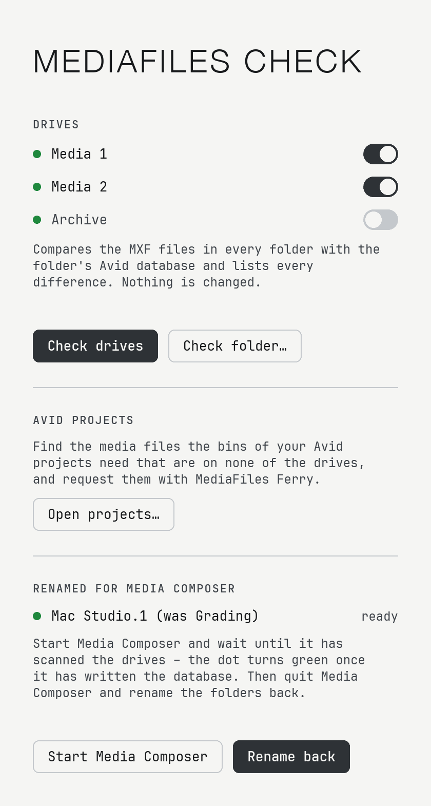
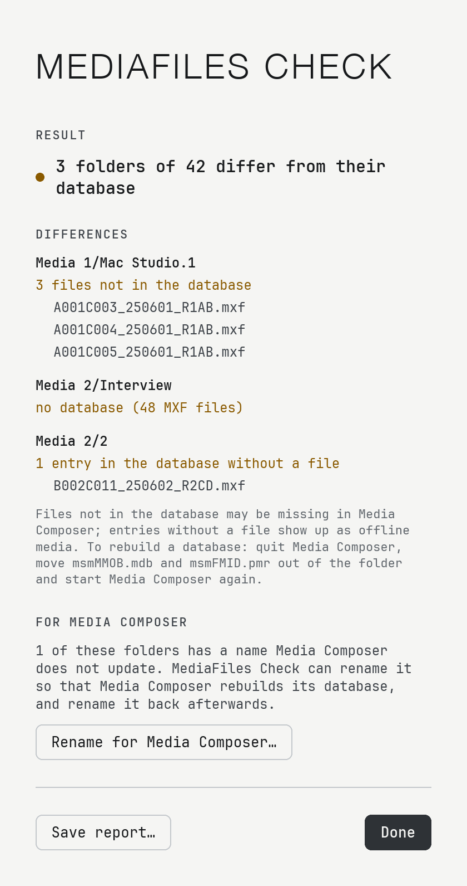
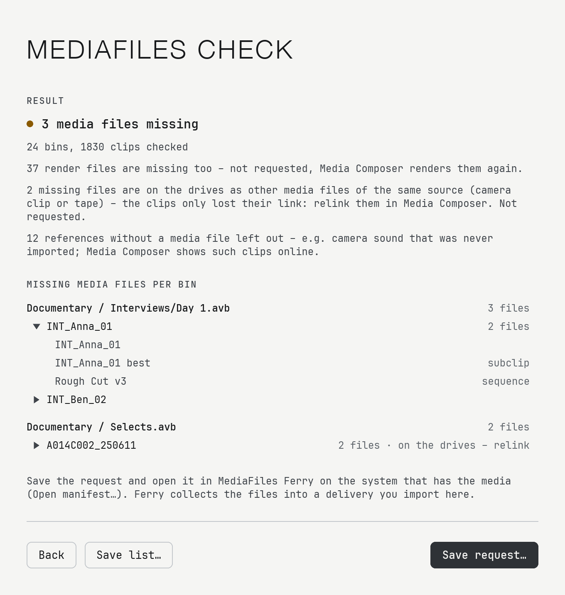

<p align="center"></p>

# MediaFiles Check

Checks whether every folder in **Avid MediaFiles/MXF** matches its Avid database – and tells you where it doesn't.

<p align="center"><picture><source media="(prefers-color-scheme: dark)" srcset="assets/screenshots/home-dark.png"></picture></p>

> **Beta.** Please report problems in [Issues](../../issues).

## What it reports

For every MXF folder (e.g. `Avid MediaFiles/MXF/1`) it compares the `.mxf` files with the list in the folder's database (`msmFMID.pmr`):

- **Files not in the database** – Media Composer may not show them.
- **Entries in the database without a file** – they show up as offline media.
- **No database, a missing database file, an empty or unreadable database.**

Checking only reads. The start page lists every drive with `Avid MediaFiles/MXF` and updates itself when a drive is connected or ejected; switch on the ones you want and click **Check drives**. **Check folder…** takes a drive, the MXF folder or a single media folder (also on network drives). **Save report…** writes every difference with all file names to a text file. English, German, French and Spanish (Settings → Language), dark or light, with a built-in manual (Help → Manual) and a log file for error reports (Help → Show Log File). Updates install from within the app (Settings… → Check for updates, or the notice at the top of the window).

<p align="center"><picture><source media="(prefers-color-scheme: dark)" srcset="assets/screenshots/result-dark.png"></picture></p>

**Rename for Media Composer:** Media Composer only rebuilds the databases of its own folders – numbers on local drives, `<computer name>.<number>` on network drives. After a check, MediaFiles Check can give other folders the next free such name, remembers the original name and every media file, shows when Media Composer has rewritten the database and renames the folders back. New files found then (e.g. recorded meanwhile) can be moved to a new numbered folder or to `1` / `<computer name>.1`, or kept. Nothing is deleted or overwritten.

**Avid projects:** choose the folder with your Avid projects, switch on the ones to check, and MediaFiles Check reads every bin (`.avb`), follows each master clip, subclip and sequence to its media files and lists those that are on none of the connected drives – per bin, each missing file once, unfolding to where it is used. Render files and AMA-linked files are only counted; files whose source is on the drives in another media file are marked for relinking instead of requested; MXF files missing from a database are identified by their header. **Save request…** writes a `…_Request.ferry` file that [MediaFiles Ferry](https://github.com/moritz-poth/mediafiles-ferry) opens on the system that has the media and turns into a normal delivery. AMA-linked clips are not requested; **Show AMA clips…** lists them per bin, so you can see where in the project they are used. Bins are read with a small reader of our own (`src/avb.rs`), based on the format knowledge of [pyavb](https://github.com/markreidvfx/pyavb) (MIT, see THIRD-PARTY.md).

<p align="center"><picture><source media="(prefers-color-scheme: dark)" srcset="assets/screenshots/projects-dark.png"></picture></p>

To rebuild a database by hand: quit Media Composer, move `msmMMOB.mdb` and `msmFMID.pmr` out of the folder, start Media Composer again.

## About the database format

Avid has not published the format of `msmFMID.pmr`. MediaFiles Check reads it as found in real databases (see `src/lib.rs`): the file holds the list of file names twice. Only if both lists agree and the file ends exactly where expected is the result used – otherwise the folder is reported as "database unreadable" instead of guessing.

## Install

Requires macOS 11 or later, Apple Silicon or Intel. Download `MediaFiles-Check-<version>.zip` from [Releases](../../releases), unzip, move the app to Applications. It is not signed with a paid Apple certificate: on first launch open **System Settings → Privacy & Security** and click **Open Anyway** (once). When macOS asks whether MediaFiles Check may access files on removable or network volumes, allow it – until then every read of a drive waits.

## Build

```
cargo test
scripts/build-mac-app.sh     # → dist/MediaFiles Check.app (universal) and a zip
cargo run --release --bin mfcheck -- [--de] [DRIVE or FOLDER...]   # same check on the command line
cargo run --release --bin mfcheck -- --projects FOLDER [REQUEST.ferry]   # missing media of Avid projects
```

## License

Copyright © 2026 Moritz Poth. Free software under the GNU General Public License v3.0 or later – see [LICENSE](LICENSE). No warranty. Font: [JetBrains Mono](https://www.jetbrains.com/lp/mono/) (SIL Open Font License, `ui/fonts/OFL.txt`).

*Avid and Media Composer are trademarks of Avid Technology, Inc. This project is not affiliated with Avid.*
