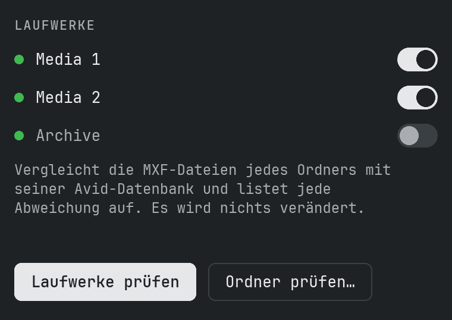
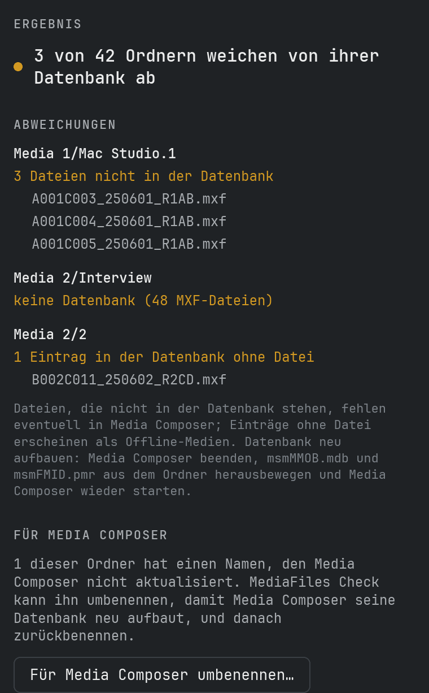
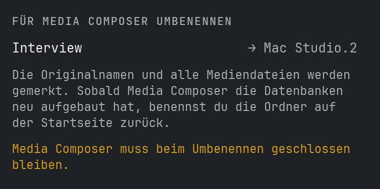
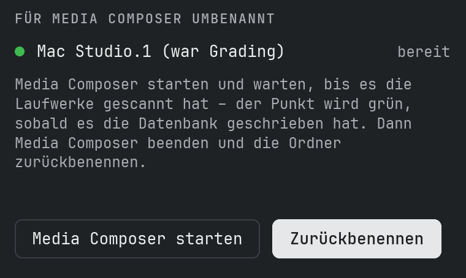
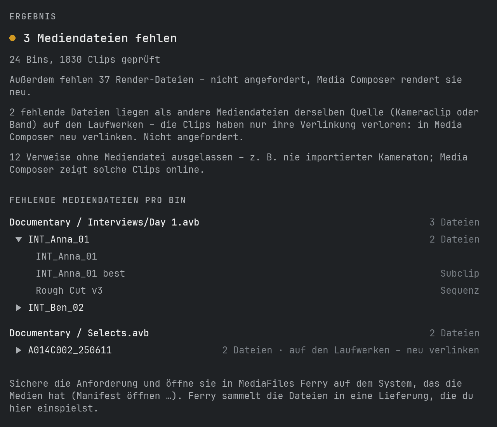

# Anleitung

## Was MediaFiles Check macht

MediaFiles Check vergleicht jeden Ordner in `Avid MediaFiles/MXF` mit seiner Avid-Datenbank und zeigt, wo beide nicht zusammenpassen. Das hilft, wenn Medien in Media Composer fehlen, offline erscheinen oder nachdem Dateien von Hand kopiert oder verschoben wurden.

Das Prüfen **liest nur**. Nur wenn du es möchtest, benennt MediaFiles Check Ordner für Media Composer um (siehe unten) – es löscht oder überschreibt nie eine Datei oder eine Datenbank.

## Was es erwartet

Auf jedem Laufwerk, auch auf Netzlaufwerken:

- `Avid MediaFiles/MXF/<Ordner>/` mit den `.mxf`-Mediendateien
- die beiden Avid-Datenbankdateien `msmFMID.pmr` und `msmMMOB.mdb` in jedem Ordner
- `Creating`-Ordner und versteckte Dateien werden ignoriert

Ordnernamen sind beliebig, z. B. `1`, `Avid8.1` oder `Mac Studio.1`.

## Laufwerke prüfen

Die Startseite zeigt jedes angeschlossene Laufwerk mit `Avid MediaFiles/MXF` – der grüne Punkt heißt: das Laufwerk ist bereit. Die Liste aktualisiert sich von selbst, wenn du ein Laufwerk anschließt oder auswirfst.

1. Schalte die Laufwerke ein, die du prüfen möchtest. Neue Laufwerke sind automatisch eingeschaltet.
2. Auf **Laufwerke prüfen** klicken.

## Einen Ordner prüfen

**Ordner prüfen…** prüft einen Ort deiner Wahl:

- ein Laufwerk – alle seine MXF-Ordner
- den `MXF`-Ordner selbst
- einen einzelnen Medienordner wie `MXF/1`
- einen beliebigen Ordner mit MXF-Ordnern darin, z. B. eine Kopie auf einer Backup-Platte

## Das Ergebnis

Das Ergebnis zeigt jeden Ordner mit Abweichungen und was gefunden wurde:

- **Dateien nicht in der Datenbank** – im Ordner liegen MXF-Dateien, die die Datenbank nicht kennt. Media Composer zeigt sie eventuell nicht an.
- **Einträge in der Datenbank ohne Datei** – die Datenbank nennt Dateien, die nicht im Ordner liegen. Sie erscheinen als Offline-Medien.
- **Keine Datenbank** – der Ordner hat MXF-Dateien, aber keine Datenbankdateien.
- **msmFMID.pmr oder msmMMOB.mdb fehlt** – eine der beiden Datenbankdateien ist weg.
- **Datenbank ist leer** – `msmFMID.pmr` hat keinen Inhalt.
- **Datenbank nicht lesbar** – die Datei ließ sich nicht lesen oder hat ein Format, das MediaFiles Check nicht kennt. Es rät nie.

Pro Befund werden bis zu 10 Dateinamen gezeigt. **Bericht sichern…** schreibt alle Abweichungen mit jedem Dateinamen in eine Textdatei.

## Für Media Composer umbenennen

Media Composer baut nur die Datenbanken seiner eigenen Ordner neu auf: Zahlenordner wie `1` oder `2` auf lokalen Laufwerken, `<Rechnername>.<Zahl>` (z. B. `Mac Studio.3`) auf Netzlaufwerken. Ordner mit anderen Namen – z. B. von einem anderen System kopiert – behalten ihre alte Datenbank.

Nach einer Prüfung bietet **Für Media Composer umbenennen…** an, solche Ordner umzubenennen:

1. Media Composer beenden und auf **Umbenennen** klicken. Jeder Ordner bekommt die nächste freie Zahl (bzw. Rechnername und Zahl). MediaFiles Check merkt sich den Originalnamen und jede Mediendatei.
2. Auf **Media Composer starten** klicken (oder es selbst starten) und warten, bis es die Laufwerke gescannt hat. Auf der Startseite wird der Punkt eines Ordners grün, sobald Media Composer seine Datenbank geschrieben hat.
3. Media Composer beenden und auf **Zurückbenennen** klicken.

Vor dem Zurückbenennen prüft MediaFiles Check jeden Ordner:

- **Neue Dateien** – meist Medien, die Media Composer in den Ordner aufgenommen hat, solange er den neuen Namen hatte. Zur Wahl: in einen neuen Zahlenordner verschieben, in den Ordner `1` (bzw. `<Rechnername>.1`) verschieben oder im Ordner lassen.
- **Dateien fehlen oder sind verändert** – du entscheidest, ob trotzdem zurückbenannt wird.
- **Datenbank noch nicht neu geschrieben** – du entscheidest, ob trotzdem zurückbenannt wird.

**Erst mal umbenannt lassen** lässt den Ordner, wie er ist; du kannst ihn später zurückbenennen. Gibt es inzwischen einen Ordner mit dem Originalnamen, wird nichts umbenannt und du bekommst einen Hinweis.

## Avid-Projekte

**Projekte öffnen…** auf der Startseite öffnet das Fenster für Avid-Projekte. Es findet die Mediendateien, die die Bins deiner Projekte brauchen und die auf keinem angeschlossenen Laufwerk liegen – und schreibt eine Anforderung für MediaFiles Ferry, das sie auf dem System einsammelt, das sie hat.

1. **Ordner wählen…** – den Ordner mit deinen Avid-Projekten. Jeder Ordner mit einer `.avp`-Datei zählt als Projekt (Sicherungen in `Attic` bleiben außen vor). Der Ordner wird gemerkt.
2. Schalte die Projekte ein, die du prüfen möchtest – anfangs sind alle aus.
3. Auf **Scannen** klicken. MediaFiles Check liest jeden Bin und verfolgt jeden Masterclip, Subclip und jede Sequenz bis zu den Mediendateien, die sie nutzen, auch über Bins des Projekts hinweg. Es vergleicht sie mit den Avid-Datenbanken aller angeschlossenen Laufwerke.
4. Das Ergebnis zeigt pro Bin jede fehlende Mediendatei einmal – benannt nach ihrem Masterclip, „3 Dateien“, wenn z. B. Bild und Ton eines Clips fehlen. Ein Klick auf eine Datei zeigt, wo sie im Bin steckt (Masterclip, Subclips, Sequenzen). **Liste sichern…** schreibt die ganze Liste in eine Textdatei.
5. **Anforderung sichern…** schreibt eine Datei `…_Request.ferry`. Öffne sie in MediaFiles Ferry auf dem System, das die Medien hat (**Manifest öffnen …**); Ferry sammelt die Dateien in eine normale Lieferung, die du hier mit **Prüfen & einspielen** einspielst.

Gut zu wissen:

- Clips und Medien werden über Avids Medien-IDs zugeordnet, nicht über Dateinamen. Eine Datei auf einem Laufwerk, die in **keiner** Avid-Datenbank steht, wird über die Medien-ID in ihrem MXF-Header erkannt; nur Dateien mit unlesbarem Header (beschädigt, noch im Schreiben) bleiben unerkannt – das Ergebnis warnt davor.
- AMA-verlinkte Dateien werden nicht angefordert. **AMA-Clips anzeigen…** öffnet ein Fenster, das zeigt, wo sie benutzt werden – aufgebaut wie die fehlenden Medien, ein Klick auf einen Clip zeigt seine Verwendungen. AMA-Clips, zu denen es einen gleichnamigen Masterclip mit Medien auf den Laufwerken gibt (z. B. erst verlinkt, später importiert), fallen weg und werden nur gezählt. Auch die gesicherte Liste enthält sie.
- Eine fehlende Datei, deren Quelle (Kameraclip oder Band, Bild oder Ton) als andere Mediendatei auf den Laufwerken liegt, wird mit **auf den Laufwerken – neu verlinken** markiert: Der Clip hat nur seine Verlinkung verloren; verlinke ihn in Media Composer neu. Sie wird nicht angefordert.
- Dateien ohne Avid-Medienverweis (z. B. über AAF importiert) werden getrennt gezählt. Ferry findet sie nur, wenn das andere System sie in Avid MediaFiles hat.
- Kamera-Masterclips haben oft Tonspuren, für die nie eine Mediendatei angelegt wurde (der Ton wurde extern aufgenommen). Diese Verweise werden ausgelassen und nur gezählt; ein Subclip braucht nur die Spuren, die er wirklich nutzt.
- Fehlende Render-Dateien (gerenderte Effekte) werden nur gezählt, nicht aufgelistet oder angefordert – Media Composer rendert sie neu.
- Ein Laufwerk, das 30 Sekunden nicht antwortet, wird übersprungen und im Ergebnis genannt.

## Datenbank neu aufbauen

1. Media Composer beenden.
2. `msmMMOB.mdb` und `msmFMID.pmr` aus dem Ordner herausbewegen, z. B. in einen Ordner auf dem Schreibtisch. Erst löschen, wenn wieder alles läuft.
3. Media Composer starten. Es schreibt eine neue Datenbank für den Ordner.
4. Den Ordner noch einmal prüfen.

## Einstellungen

**MediaFiles Check → Einstellungen…** (⌘,) stellt die Darstellung (Schalter **Hell/Dunkel**, an = dunkel) und die Sprache (English, Deutsch, Français, Español) ein. **MediaFiles Check → Über MediaFiles Check** zeigt Version und Lizenz.

## Updates

MediaFiles Check sucht kurz nach dem Start und alle 6 Stunden auf GitHub nach einer neuen Version; **Einstellungen… → Nach Updates suchen** sucht sofort. Eine neue Version erscheint oben im Hauptfenster: **Neuigkeiten** öffnet die Versionshinweise, **Update installieren** lädt sie, prüft, dass sie vollständig und unverändert ist, legt die alte Version in den Papierkorb und startet die App neu.

## Support

**Einstellungen… → Support** bietet vier Dinge:

- **Selbsttest…** prüft Datenbanken lesen, Vergleichen, Umbenennen für Media Composer und zurück sowie Updates – mit eigenen Testdaten in einem temporären Ordner. Deine Laufwerke werden nur aufgelistet, nie verändert. **Bericht senden** schickt uns das Ergebnis anonym; **Speichern** legt es in „Downloads“, damit du es vorher ansehen kannst.
- **Melden…** schickt uns ein Problem oder eine Idee – ohne GitHub-Konto. Du kannst deine E-Mail für Rückfragen angeben und Systeminfo und Logdatei anhängen; dein Benutzername und Ordnernamen werden ersetzt.
- **Logdatei zeigen** (siehe unten).
- **Spendier mir einen Kaffee** – wenn du MediaFiles Check nutzt und es dir gefällt, freue ich mich über einen Kaffee.

Klappt das Senden nicht, liegt der Bericht in „Downloads“.

## Logdatei

MediaFiles Check schreibt, was es tut – Prüfungen, Umbenennungen, Fehler – in eine Logdatei. **Hilfe → Logdatei zeigen** zeigt sie im Finder; schick sie mit, wenn du ein Problem meldest.
