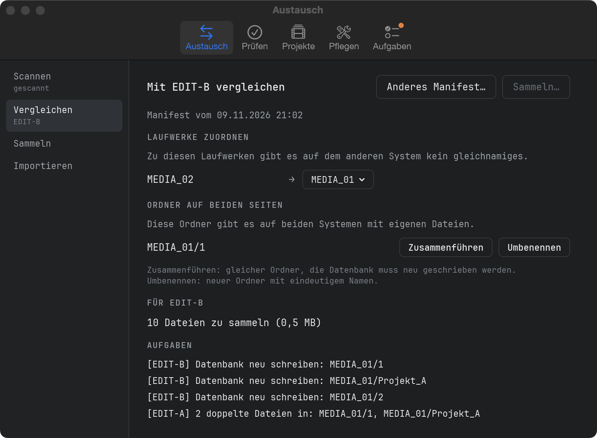
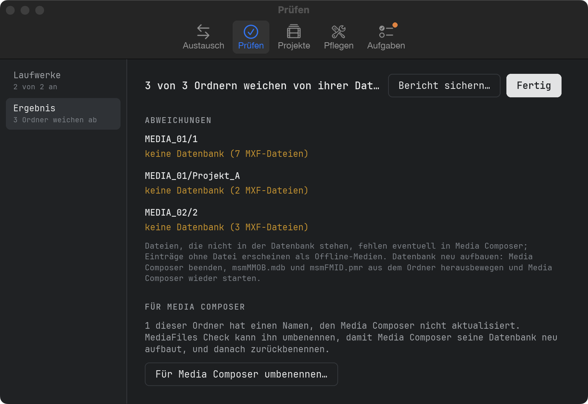
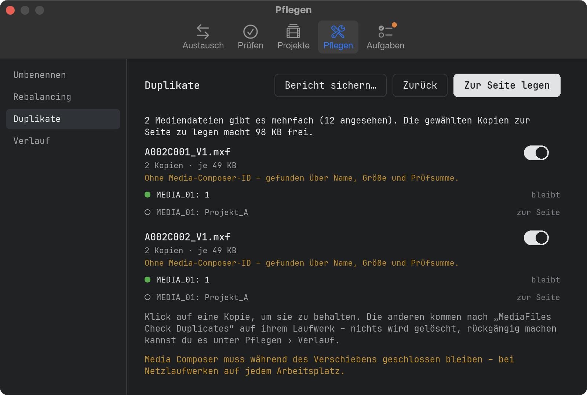
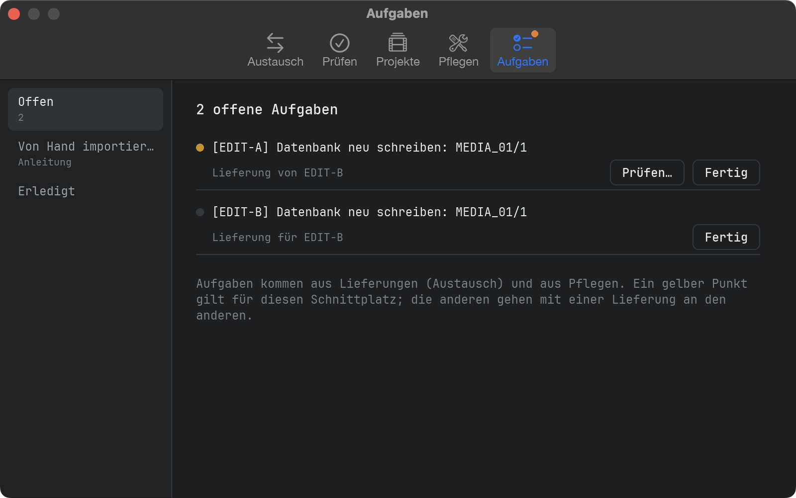
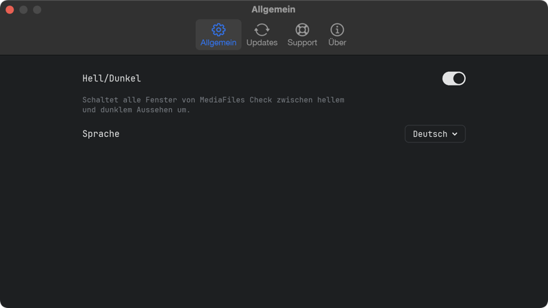

# Anleitung

## Was MediaFiles Check macht

MediaFiles Check kümmert sich um die Avid-Mediendateien (MXF) deiner Schnittplätze:

- **Austausch** gleicht die Medien zweier Schnittplätze ab, auch wenn sie nicht verbunden sind (früher MediaFiles Ferry).
- **Prüfen** vergleicht jeden Ordner in `Avid MediaFiles/MXF` mit seiner Avid-Datenbank und zeigt, wo beide nicht zusammenpassen.
- **Projekte** findet die Mediendateien, die die Bins deiner Avid-Projekte brauchen, die aber auf keinem Laufwerk liegen, und fordert sie an.
- **Pflegen** enthält die Werkzeuge, die etwas verändern: Ordner für Media Composer umbenennen, Rebalancing, Duplikate und ihr Verlauf.
- **Aufgaben** sammelt alles, was von Hand zu tun ist.

MediaFiles Check **löscht nie** eine Mediendatei und **überschreibt nie** eine. Prüfen liest nur.

## Das Fenster

Die Reiter oben sind die Bereiche. In jedem Reiter stehen links in der Seitenleiste seine Schritte in der Reihenfolge, in der man sie macht; unter jedem Schritt steht kurz sein Stand. Ein kleiner oranger Punkt auf einem Reiter heißt: Dort wartet etwas.

## Was erwartet wird

Auf jedem Laufwerk, auch auf Netzlaufwerken:

- `Avid MediaFiles/MXF/<Ordner>/` mit den `.mxf`-Mediendateien
- die beiden Avid-Datenbankdateien `msmFMID.pmr` und `msmMMOB.mdb` in jedem Ordner
- `Creating`-Ordner und versteckte Dateien werden ignoriert

Die Ordner dürfen beliebig heißen, z. B. `1`, `Avid8.1` oder `Mac Studio.1`. Jedes angeschlossene Laufwerk mit `Avid MediaFiles/MXF` hat einen Schalter; dieselben Schalter gelten für Austausch › Scannen und Prüfen › Laufwerke und werden gemerkt. Neue Laufwerke sind eingeschaltet.

## Austausch: Scannen

Austausch › **Scannen** erfasst jede MXF-Datei der eingeschalteten Laufwerke mit Prüfsumme und schreibt ein kleines *Manifest* – eine Dateiliste, keine Medien.

- Der erste Scan dauert, weil jede Datei einmal gelesen wird. Spätere Scans lesen nur neue oder geänderte Dateien.
- Wird die App während eines Scans beendet, geht nichts verloren – der nächste Scan macht weiter.

**Manifest sichern…** speichert es z. B. als `261101-1312_Mac Studio_Manifest.ferry`. Schick es an den anderen Schnittplatz, z. B. per Mail oder USB-Stick.

## Austausch: Vergleichen und Sammeln

1. Zuerst diesen Schnittplatz scannen, damit das eigene Manifest aktuell ist.
2. Austausch › **Vergleichen** → **Manifest öffnen…** und das Manifest des anderen Schnittplatzes wählen – oder eine Anforderung aus Projekte › Anfordern.
3. **Laufwerke zuordnen:** Laufwerke ohne gleichnamiges Laufwerk auf der anderen Seite brauchen ein Ziel – oder **Nicht senden**. Die Wahl wird gemerkt.
4. **Ordner auf beiden Seiten:** für jeden Ordner **Zusammenführen** oder **Umbenennen** wählen (siehe unten).
5. Anzahl der Dateien und die Aufgaben prüfen, dann **Sammeln…** und wählen, wo der Lieferordner entstehen soll.

Jede Datei wird mit Prüfsumme in einen neuen Ordner wie `261102-1830_Mac Studio_to_MacBook` kopiert, zusammen mit `Aufgaben.txt` (Anleitung zum Importieren von Hand). Nochmal Sammeln nach einer Unterbrechung macht dort weiter, wo es aufgehört hat.

## Austausch: Importieren

1. Media Composer beenden.
2. Austausch › **Importieren** → **Lieferung wählen…**.
3. Jedes Laufwerk der Lieferung braucht ein Laufwerk auf diesem Schnittplatz; gleichnamige werden automatisch zugeordnet.
4. **Prüfen & importieren** prüft zuerst jede Datei. Nur eine vollständige, unbeschädigte Lieferung wird importiert – Dateien kommen nur dazu, eine Mediendatei wird nie überschrieben. Ersetzte Datenbanken bleiben in `Avid MediaFiles/Ferry-Backup/`.
5. Danach noch einmal scannen, damit das Manifest aktuell ist.

## Wann wird etwas kopiert?

Eine Datei gilt als **vorhanden**, wenn sie irgendwo auf dem anderen Schnittplatz mit gleichem Namen und gleicher Prüfsumme liegt.

- **Ordner auf beiden Seiten gleich:** nichts passiert.
- **Ordner fehlt auf der anderen Seite:** der ganze Ordner wird kopiert, samt Datenbank.
- **Eine Seite hat zusätzliche Dateien:** die Dateien und die Datenbank der volleren Seite werden kopiert.
- **Beide Seiten haben eigene Dateien:** nur die Dateien werden kopiert – Aufgabe „Datenbank neu bauen“.
- **Gleicher Dateiname, anderer Inhalt:** nicht kopiert – eine Aufgabe bittet um Prüfung.

Eine Datenbank wird nur geliefert, wenn der Zielordner danach genau wie der Quellordner aussieht; eine Datenbank wird nie gelöscht. Ordner wie `1` gibt es auf jedem Schnittplatz: **Zusammenführen** legt die Dateien in denselben Ordner (die Datenbank muss neu gebaut werden), **Umbenennen** in einen neuen Ordner wie `261031_MacStudio_1`.

## Laufwerke prüfen

Prüfen › **Laufwerke** listet jedes angeschlossene Laufwerk – der grüne Punkt heißt: bereit. Die zu prüfenden Laufwerke einschalten und **Prüfen** klicken. **Ordner prüfen…** prüft einen Ort deiner Wahl: ein Laufwerk, den Ordner `MXF`, einen einzelnen Ordner wie `MXF/1` oder eine Kopie auf einem Backup-Laufwerk.

## Das Ergebnis

Prüfen › **Ergebnis** listet jeden Ordner mit Abweichung:

- **Dateien nicht in der Datenbank** – Media Composer zeigt sie womöglich nicht.
- **Einträge in der Datenbank ohne Datei** – sie erscheinen als Offline-Medien.
- **Keine Datenbank** / **msmFMID.pmr oder msmMMOB.mdb fehlt** / **Datenbank ist leer**.
- **Datenbank unlesbar** – ein unbekanntes Format. MediaFiles Check rät nie.

Pro Befund stehen bis zu 10 Dateinamen da; **Bericht sichern…** schreibt alle in eine Textdatei. Für Ordner, die Media Composer nicht selbst aktualisiert, gibt es gleich dort **Für Media Composer umbenennen…**.

## Projekte

1. Projekte › **Projekte wählen** → **Ordner wählen…**: der Ordner mit deinen Avid-Projekten (jeder Ordner mit einer `.avp`-Datei; `Attic` bleibt außen vor). Er wird gemerkt. Die zu prüfenden Projekte einschalten und **Scannen** klicken.
2. **Fehlende Medien** listet pro Bin jede fehlende Mediendatei einmal, benannt nach ihrem Master-Clip. Ein Klick zeigt, wo sie verwendet wird. **Liste sichern…** schreibt die ganze Liste.
3. **AMA-Clips** zeigt, wo AMA-verknüpfte Dateien verwendet werden. Sie werden nicht angefordert.
4. **Anfordern** → **Anforderung sichern…** schreibt eine `…_Request.ferry`-Datei. Schick sie an den Schnittplatz, der die Medien hat; dort: Austausch › Vergleichen, Datei öffnen, dann Sammeln. Hier: Austausch › Importieren der Lieferung.

Gut zu wissen:

- Clips werden über Avids Medien-IDs mit ihren Medien verbunden, nicht über Dateinamen. Eine Datei in keiner Avid-Datenbank wird über die ID in ihrem MXF-Kopf erkannt.
- Eine fehlende Datei, deren Quelle in einer anderen Mediendatei auf den Laufwerken liegt, ist mit **auf den Laufwerken – neu verknüpfen** markiert: in Media Composer neu verknüpfen. Sie wird nicht angefordert.
- Dateien ohne Avid-Medienverweis (z. B. per AAF importiert) werden extra gezählt; der Austausch findet sie nur, wenn der andere Schnittplatz sie in Avid MediaFiles hat.
- Kamera-Tonspuren, für die nie eine Mediendatei entstand, und fehlende Render-Dateien werden nur gezählt.
- Ein Laufwerk, das 30 Sekunden nicht antwortet, wird übersprungen und im Ergebnis genannt.

## Für Media Composer umbenennen

Media Composer baut nur die Datenbanken seiner eigenen Ordner neu: nummerierte Ordner wie `1` auf lokalen Laufwerken, `<Rechnername>.<Nummer>` auf Netzlaufwerken. Andere Ordner – z. B. von einem anderen Schnittplatz kopiert – behalten ihre alte Datenbank. Pflegen › **Umbenennen** zeigt oben den Ablauf: Umbenennen — Media Composer schreibt — Zurückbenennen.

1. Media Composer beenden und die Ordner umbenennen (aus Prüfen › Ergebnis, oder beim Rebalancing bzw. Beiseitelegen von Duplikaten). Jeder bekommt die nächste freie Nummer; der Originalname und jede Mediendatei werden gemerkt.
2. **Media Composer starten** und warten, bis er die Laufwerke gelesen hat. Der Punkt eines Ordners wird grün, sobald Media Composer seine Datenbank geschrieben hat.
3. Media Composer beenden und **Zurückbenennen** klicken.

Vor dem Zurückbenennen wird jeder Ordner geprüft: **neue Dateien** (meist aufgenommen, während der Ordner umbenannt war – in einen neuen Ordner, nach Ordner `1` verschieben oder im Ordner lassen), **Dateien fehlen oder geändert**, **Datenbank noch nicht neu geschrieben**. **Erst mal umbenannt lassen** lässt ihn, wie er ist.

Die Originalnamen werden gespeichert, bevor etwas umbenannt wird, und überstehen so einen Absturz oder Neustart. Ein Ordner wird an seinem Laufwerk, seinem jetzigen Namen und seinen Mediendateien erkannt; ein Laufwerk, das unter anderem Namen zurückkommt, wird wiedergefunden. Ein umbenannter Ordner, der von Hand gelöscht oder weggeschoben wurde, verschwindet aus der Liste.

## Rebalancing

Wir empfehlen höchstens 5000 Dateien pro MXF-Ordner. Die Grenze (Einstellungen → Rebalancing) zählt jede Datei eines Ordners, die zwei Datenbankdateien eingeschlossen.

Ein Ordner und seine rebalanced-Ordner (`<Name>-rebalanced-1`, `-2` …) gehören zusammen. Rebalancing verteilt die ganze Gruppe: Die ältesten Mediendateien kommen nach `-rebalanced-1`, die nächsten nach `-2` …, die jüngsten bleiben im Hauptordner. Pflegen › **Rebalancing** → **Volle Ordner suchen…** listet jede Gruppe auf den eingeschalteten Laufwerken, die nicht zur Grenze passt.

1. Media Composer beenden – bei Netzlaufwerken auf jedem Arbeitsplatz – und die Gruppen wählen.
2. **Rebalancing starten** klicken. Für einen Ordner, den Media Composer selbst anlegt (`1`, `<Rechnername>.1`), empfehlen wir vorher einen eigenen Namen. Nichts wird kopiert oder gelöscht; ein rebalanced-Ordner ohne Mediendateien wandert als Ganzes nach `MediaFiles Check Database Backups`.
3. Danach müssen die Datenbanken der geänderten Ordner neu geschrieben werden. **Starten** legt ihre Datenbankdateien nach `MediaFiles Check Database Backups` auf demselben Laufwerk und benennt die Ordner um, die Media Composer nicht selbst aktualisiert; weiter unter Pflegen › Umbenennen. **Abbrechen** lässt die Datenbanken, wie sie sind – es bleibt in Aufgaben und Verlauf stehen.

Jede Änderung der Grenze fragt vorher nach; das nächste **Volle Ordner suchen…** verteilt jede Gruppe neu.

## Duplikate

Pflegen › **Duplikate** → **Duplikate suchen…** sucht auf den eingeschalteten Laufwerken nach Mediendateien, die es mehrfach gibt – über ihre Media-Composer-ID, also auch umbenannte Kopien; Dateien ohne ID über Name, Größe und Prüfsumme. Mountpoint-Arbeitsbereiche bleiben außen vor.

Der grüne Punkt zeigt die Kopie, die bleibt (die, die die Datenbank ihres Ordners kennt, sonst die älteste) – ein Klick auf eine andere Kopie behält diese. Kopien mit gleicher ID, aber anderer Größe sind nicht von selbst eingeschaltet. **Zur Seite legen** verschiebt die anderen Kopien nach `MediaFiles Check Duplicates` auf ihrem Laufwerk; ein Ordner ohne Mediendateien geht mit. Danach werden die Datenbanken neu geschrieben wie beim Rebalancing.

## Verlauf

Pflegen › **Verlauf** listet jeden Lauf von Rebalancing und Duplikaten: **Datenbanken neu schreiben** holt den Datenbank-Schritt nach, **Rückgängig** schiebt alles zurück (nie über eine vorhandene Datei) – umbenannte Ordner vorher zurückbenennen.

## Aufgaben

Aufgaben › **Offen** listet alles, was von Hand zu tun ist: Aufgaben von Lieferungen, die hier gesammelt oder importiert wurden (der Schnittplatz steht in eckigen Klammern; ein gelber Punkt heißt: dieser Schnittplatz), Datenbanken, die nach Rebalancing oder Duplikaten noch neu geschrieben werden müssen, und Ordner, die aufs Zurückbenennen warten. Wo die App helfen kann, steht der Knopf direkt daneben – z. B. **Prüfen…** für einen Ordner dieses Schnittplatzes, der eine neue Datenbank braucht. **Fertig** schiebt eine Aufgabe nach **Erledigt**.

**Von Hand importieren** erklärt, wie man eine Lieferung ohne die App importiert. Die wichtigste Regel: nur den Inhalt des Lieferordners kopieren – nie den ganzen Ordner auf einen bestehenden ziehen, der Finder würde ihn samt allen Mediendateien ersetzen.

## Eine Datenbank neu bauen

1. Media Composer beenden.
2. `msmMMOB.mdb` und `msmFMID.pmr` aus dem Ordner schieben, z. B. in einen Ordner auf dem Schreibtisch. Erst löschen, wenn alles wieder läuft.
3. Media Composer starten. Er schreibt eine neue Datenbank für den Ordner.
4. Den Ordner noch einmal prüfen.

Für Ordner, die Media Composer nicht selbst aktualisiert, stattdessen Pflegen › Umbenennen nehmen.

## Einstellungen

**MediaFiles Check → Einstellungen…** (⌘,) öffnet das Einstellungsfenster: **Allgemein** (Hell/Dunkel, Sprache), **Rebalancing** (Dateien pro Ordner), **Updates**, **Support** und **Über**.

## Updates

MediaFiles Check sucht kurz nach dem Start und alle 6 Stunden auf GitHub nach einer neuen Version; **Einstellungen… → Updates → Nach Updates suchen** sucht sofort. Eine neue Version erscheint als Leiste unter den Reitern: **Neuigkeiten** öffnet die Versionshinweise, **Update installieren** lädt sie, prüft, dass sie vollständig und unverändert ist, legt die alte Version in den Papierkorb und startet die App neu. **Testversionen erhalten** bietet auch Versionen an, die noch getestet werden.

## Support

**Einstellungen… → Support**:

- **Selbsttest…** prüft Datenbanken lesen, Vergleichen, Umbenennen und Updates an eigenen Testdaten. **Bericht senden** schickt das Ergebnis anonym; **Speichern** legt es in Downloads.
- **Melden…** schickt uns ein Problem oder eine Idee – kein GitHub-Konto nötig.
- **Logdatei zeigen** (siehe unten).
- **Spendier mir einen Kaffee** – wenn du MediaFiles Check benutzt und magst, freue ich mich über einen Kaffee.

Klappt das Senden nicht, wird der Bericht in Downloads gesichert.

## Logdatei

MediaFiles Check schreibt mit, was es tut – Prüfungen, Scans, Lieferungen, Umbenennungen, Fehler. **Hilfe → Logdatei zeigen** zeigt sie im Finder; schick sie mit, wenn du ein Problem meldest.
