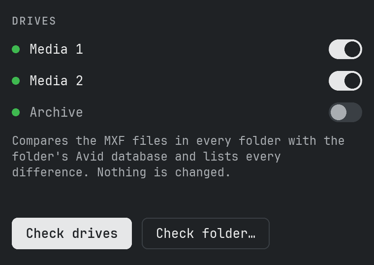
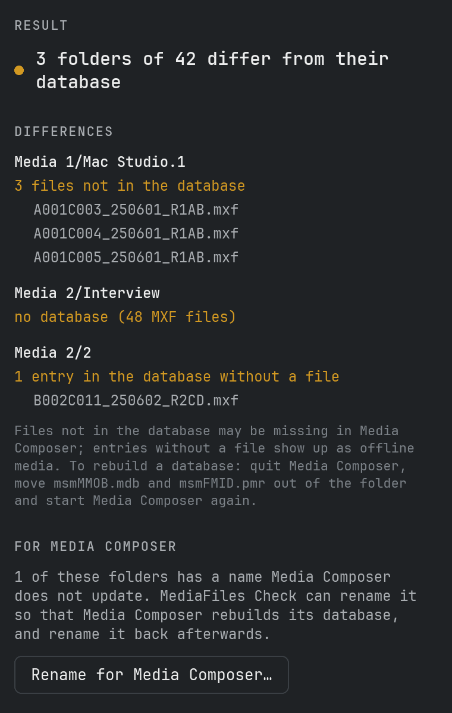
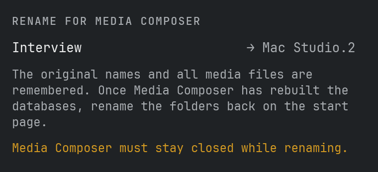
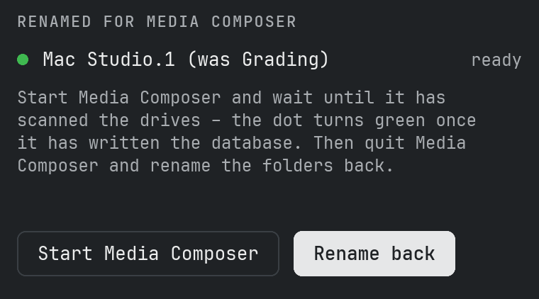
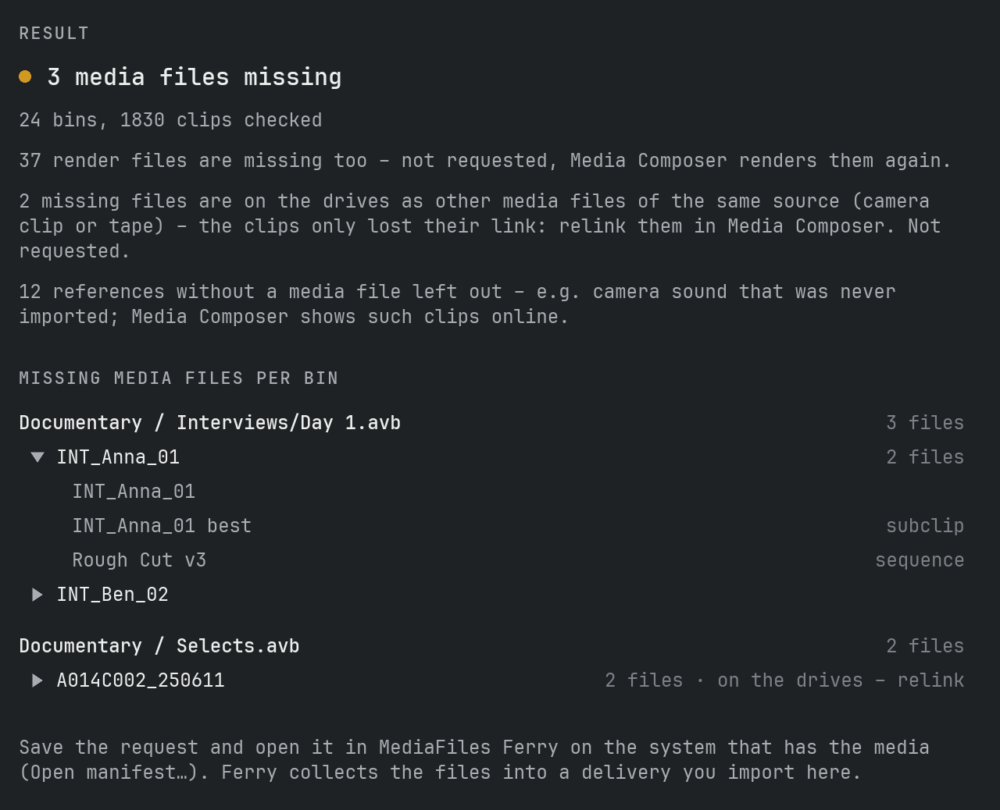
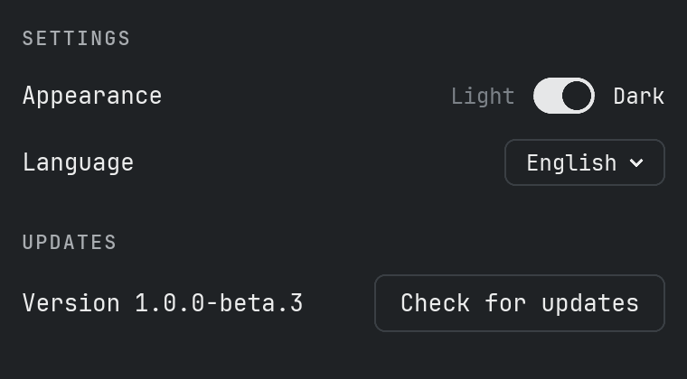

# Manual

## What MediaFiles Check does

MediaFiles Check compares every folder in `Avid MediaFiles/MXF` with its Avid database and shows where the two don't match. That helps when media is missing in Media Composer, shows up as offline, or after files were copied or moved by hand.

Checking **only reads**. Only if you ask for it does MediaFiles Check rename folders for Media Composer (see below) – it never deletes or overwrites a file or a database.

## What it expects

On every drive, including network drives:

- `Avid MediaFiles/MXF/<folder>/` with the `.mxf` media files
- the two Avid database files `msmFMID.pmr` and `msmMMOB.mdb` in each folder
- `Creating` folders and hidden files are ignored

Folder names can be anything, e.g. `1`, `Avid8.1` or `Mac Studio.1`.

## Check drives

The start page lists every connected drive with `Avid MediaFiles/MXF` – the green dot means the drive is ready. The list updates by itself when you connect or eject a drive.

1. Switch on the drives you want to check. New drives are switched on automatically.
2. Click **Check drives**.

## Check a folder

**Check folder…** checks a place you choose:

- a drive – all of its MXF folders
- the `MXF` folder itself
- a single media folder like `MXF/1`
- any folder that contains MXF folders, e.g. a copy on a backup drive

## The result

The result lists every folder that differs, with what was found:

- **Files not in the database** – the folder contains MXF files the database does not list. Media Composer may not show them.
- **Entries in the database without a file** – the database lists files that are not in the folder. They show up as offline media.
- **No database** – the folder has MXF files but no database files.
- **msmFMID.pmr or msmMMOB.mdb is missing** – one of the two database files is gone.
- **Database is empty** – `msmFMID.pmr` has no content.
- **Database unreadable** – the file could not be read or has a format MediaFiles Check does not know. It never guesses.

Up to 10 file names are shown per finding. **Save report…** writes all differences with every file name to a text file.

## Rename for Media Composer

Media Composer only rebuilds the databases of its own folders: numbered folders like `1` or `2` on local drives, `<computer name>.<number>` (e.g. `Mac Studio.3`) on network drives. Folders with other names – e.g. copied from another system – keep their old database.

After a check, **Rename for Media Composer…** offers to rename such folders:

1. Quit Media Composer and click **Rename**. Each folder gets the next free number (or computer name and number). MediaFiles Check remembers the original name and every media file.
2. Click **Start Media Composer** (or start it yourself) and wait until it has scanned the drives. On the start page the dot of a folder turns green once Media Composer has written its database.
3. Quit Media Composer and click **Rename back**.

Before renaming back, MediaFiles Check checks every folder:

- **New files** – usually media Media Composer recorded into the folder while it had the new name. Choose: move them to a new numbered folder, move them to folder `1` (or `<computer name>.1`), or keep them in the folder.
- **Files missing or changed** – you decide whether to rename back anyway.
- **Database not rewritten yet** – you decide whether to rename back anyway.

**Leave it renamed for now** keeps the folder as it is; you can rename it back later. If a folder with the original name exists meanwhile, nothing is renamed and you are told.

## Avid projects

**Open projects…** on the start page opens the window for Avid projects. It finds the media files the bins of your projects need that are on none of the connected drives – and writes a request for MediaFiles Ferry, which collects them on the system that has them.

1. **Choose folder…** – the folder with your Avid projects. Every folder with an `.avp` file counts as a project (backups in `Attic` are left out). The folder is remembered.
2. Switch on the projects you want to check – all are off at first.
3. Click **Scan**. MediaFiles Check reads every bin and follows every master clip, subclip and sequence to the media files it uses, also across bins of the project. It compares them with the Avid databases of all connected drives.
4. The result lists, per bin, each missing media file once – named after its master clip, "3 files" when e.g. video and audio of a clip are missing. Click a file to see where in the bin it is used (master clip, subclips, sequences). **Save list…** writes the whole list to a text file.
5. **Save request…** writes a `…_Request.ferry` file. Open it in MediaFiles Ferry on the system that has the media (**Open manifest…**); Ferry collects the files into a normal delivery, which you then import here with **Verify & import**.

Good to know:

- Clips are matched with their media through Avid's media IDs, not file names. A file on a drive that is in **no** Avid database is identified by the media ID in its MXF header; only files whose header cannot be read (damaged, still being written) stay unrecognised – the result warns about them.
- AMA-linked files are left out (only counted).
- A missing file whose source (camera clip or tape, picture or sound) is on the drives in another media file is marked **on the drives – relink**: the clip only lost its link; relink it in Media Composer. It is not requested.
- Files without an Avid media reference (e.g. imported via AAF) are counted separately. Ferry only finds them if the other system has them in Avid MediaFiles.
- Master clips from the camera often carry sound tracks for which no media file was ever made (the sound was recorded separately). These references are left out and only counted; a subclip only needs the tracks it actually uses.
- Missing render files (rendered effects) are only counted, not listed or requested – Media Composer renders them again.
- A drive that does not answer for 30 seconds is skipped and named in the result.

## Rebuild a database

1. Quit Media Composer.
2. Move `msmMMOB.mdb` and `msmFMID.pmr` out of the folder, e.g. into a folder on the desktop. Don't delete them until everything works again.
3. Start Media Composer. It writes a new database for the folder.
4. Check the folder again.

## Settings

**MediaFiles Check → Settings…** (⌘,) sets the appearance (light or dark) and the language (English, Deutsch, Français, Español). **MediaFiles Check → About MediaFiles Check** shows the version and the license.

## Updates

MediaFiles Check looks for a new version on GitHub shortly after starting and every 6 hours; **Settings… → Check for updates** looks right away. A new version shows at the top of the main window: **What's new** opens the release notes, **Install update** downloads it, checks that it is complete and unchanged, puts the old version in the Trash and restarts the app.

## Log file

MediaFiles Check writes what it does – checks, renames, errors – to a log file. **Help → Show Log File** shows it in the Finder; send it along when you report a problem.
