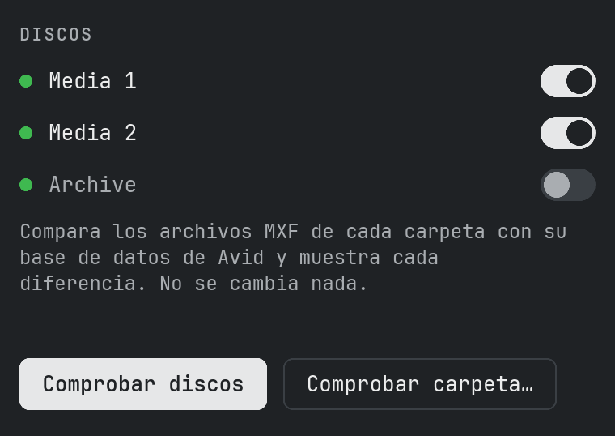
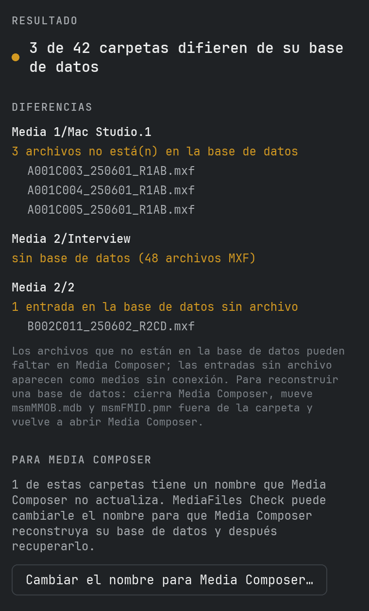
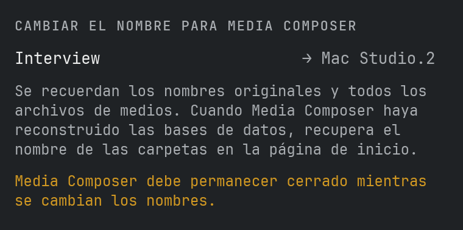
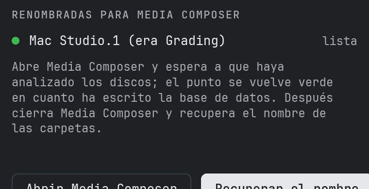
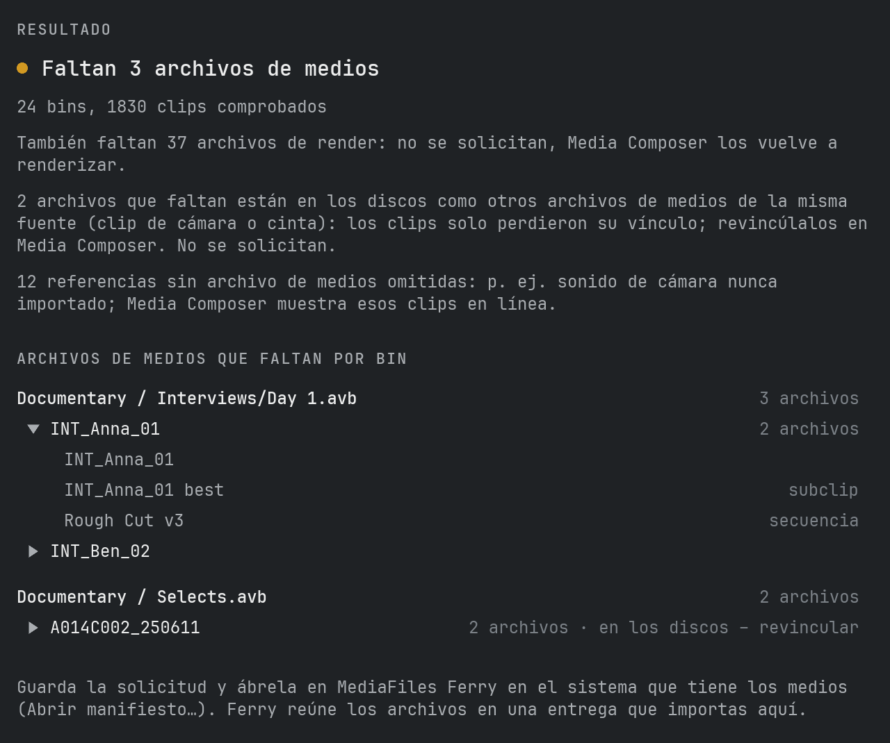
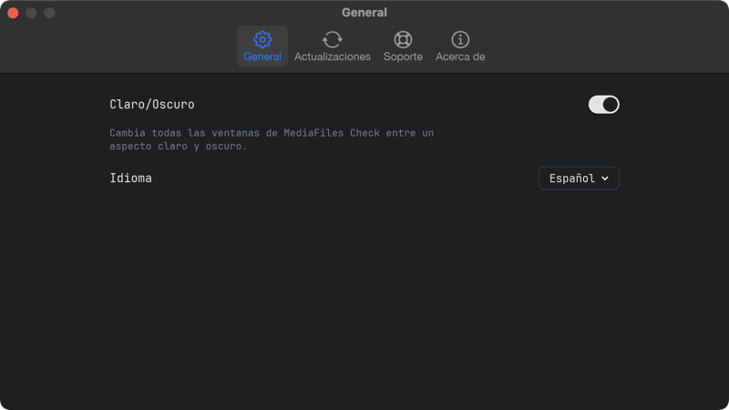

# Manual

## Qué hace MediaFiles Check

MediaFiles Check compara cada carpeta de `Avid MediaFiles/MXF` con su base de datos de Avid y muestra dónde no coinciden. Ayuda cuando faltan medios en Media Composer, aparecen sin conexión o después de copiar o mover archivos a mano.

La comprobación **solo lee**. Solo si tú lo pides, MediaFiles Check cambia el nombre de carpetas para Media Composer (ver abajo); nunca borra ni sobrescribe un archivo o una base de datos.

## Qué espera

En cada disco, también en discos de red:

- `Avid MediaFiles/MXF/<carpeta>/` con los archivos de medios `.mxf`
- los dos archivos de base de datos de Avid `msmFMID.pmr` y `msmMMOB.mdb` en cada carpeta
- las carpetas `Creating` y los archivos ocultos se ignoran

Los nombres de carpeta pueden ser cualquiera, p. ej. `1`, `Avid8.1` o `Mac Studio.1`.

## Comprobar discos

La página de inicio muestra cada disco conectado con `Avid MediaFiles/MXF`; el punto verde indica que el disco está listo. La lista se actualiza sola cuando conectas o expulsas un disco.

1. Activa los discos que quieres comprobar. Los discos nuevos se activan automáticamente.
2. Haz clic en **Comprobar discos**.

## Comprobar una carpeta

**Comprobar carpeta…** comprueba un lugar que elijas:

- un disco: todas sus carpetas MXF
- la propia carpeta `MXF`
- una sola carpeta de medios como `MXF/1`
- cualquier carpeta que contenga carpetas MXF, p. ej. una copia en un disco de respaldo

## El resultado

El resultado muestra cada carpeta con diferencias y lo que se encontró:

- **Archivos que no están en la base de datos**: la carpeta contiene archivos MXF que la base de datos no conoce. Puede que Media Composer no los muestre.
- **Entradas de la base de datos sin archivo**: la base de datos nombra archivos que no están en la carpeta. Aparecen como medios sin conexión.
- **Sin base de datos**: la carpeta tiene archivos MXF pero ningún archivo de base de datos.
- **Falta msmFMID.pmr o msmMMOB.mdb**: falta uno de los dos archivos de base de datos.
- **Base de datos vacía**: `msmFMID.pmr` no tiene contenido.
- **Base de datos ilegible**: el archivo no se pudo leer o tiene un formato que MediaFiles Check no conoce. Nunca adivina.

Se muestran hasta 10 nombres de archivo por hallazgo. **Guardar informe…** escribe todas las diferencias con cada nombre de archivo en un archivo de texto.

## Cambiar el nombre para Media Composer

Media Composer solo reconstruye las bases de datos de sus propias carpetas: carpetas numeradas como `1` o `2` en discos locales, `<nombre del ordenador>.<número>` (p. ej. `Mac Studio.3`) en discos de red. Las carpetas con otros nombres, p. ej. copiadas de otro sistema, conservan su base de datos antigua.

Después de una comprobación, **Cambiar el nombre para Media Composer…** ofrece cambiar el nombre de esas carpetas:

1. Cierra Media Composer y haz clic en **Cambiar el nombre**. Cada carpeta recibe el siguiente número libre (o nombre del ordenador y número). MediaFiles Check recuerda el nombre original y cada archivo de medios.
2. Haz clic en **Abrir Media Composer** (o ábrelo tú) y espera a que haya analizado los discos. En la página de inicio, el punto de una carpeta se vuelve verde en cuanto Media Composer ha escrito su base de datos.
3. Cierra Media Composer y haz clic en **Recuperar el nombre**.

Antes de recuperar el nombre, MediaFiles Check comprueba cada carpeta:

- **Archivos nuevos**: normalmente medios que Media Composer grabó en la carpeta mientras tenía el nombre nuevo. Puedes elegir: moverlos a una carpeta numerada nueva, moverlos a la carpeta `1` (o `<nombre del ordenador>.1`) o dejarlos en la carpeta.
- **Archivos que faltan o han cambiado**: tú decides si se recupera el nombre de todos modos.
- **Base de datos aún no reescrita**: tú decides si se recupera el nombre de todos modos.

**Dejarla así por ahora** deja la carpeta como está; puedes recuperar el nombre más tarde. Si mientras tanto existe una carpeta con el nombre original, no se cambia nada y se te avisa.

Los nombres originales se guardan antes de renombrar nada, así que sobreviven a un cierre inesperado, a salir de la app o a un reinicio: en el siguiente inicio las carpetas renombradas vuelven a aparecer en la página de inicio. Una carpeta se reconoce por su unidad, su nombre actual y sus archivos de medios; una unidad que vuelve con otro nombre (p. ej. `Media 1`) se encuentra de nuevo por sus archivos de medios.

## Proyectos de Avid

**Abrir proyectos…** en la página de inicio abre la ventana de proyectos de Avid. Encuentra los archivos de medios que necesitan los bins de tus proyectos y que no están en ningún disco conectado, y escribe una solicitud para MediaFiles Ferry, que los reúne en el sistema que los tiene.

1. **Elegir carpeta…**: la carpeta con tus proyectos de Avid. Cada carpeta con un archivo `.avp` cuenta como proyecto (las copias de seguridad en `Attic` se omiten). La carpeta se recuerda.
2. Activa los proyectos que quieres comprobar; al principio todos están desactivados.
3. Haz clic en **Analizar**. MediaFiles Check lee cada bin y sigue cada master clip, subclip y secuencia hasta los archivos de medios que usan, también entre bins del proyecto. Los compara con las bases de datos de Avid de todos los discos conectados.
4. El resultado muestra, por bin, cada archivo de medios que falta una sola vez, con el nombre de su master clip y «3 archivos» cuando faltan p. ej. la imagen y el sonido de un clip. Haz clic en un archivo para ver dónde se usa en el bin (master clip, subclips, secuencias). **Guardar lista…** escribe la lista completa en un archivo de texto.
5. **Guardar solicitud…** escribe un archivo `…_Request.ferry`. Ábrelo en MediaFiles Ferry en el sistema que tiene los medios (**Abrir manifiesto…**); Ferry reúne los archivos en una entrega normal, que luego importas aquí con **Comprobar e importar**.

Conviene saber:

- Clips y medios se asocian por los identificadores de medios de Avid, no por los nombres de archivo. Un archivo de un disco que no está en **ninguna** base de datos de Avid se identifica por el identificador de medios de su cabecera MXF; solo los archivos con cabecera ilegible (dañados, aún escribiéndose) quedan sin reconocer: el resultado lo advierte.
- Los archivos vinculados por AMA no se solicitan. **Mostrar clips AMA…** abre una ventana que muestra dónde se usan: igual que los medios que faltan, un clic en un clip muestra sus usos. Los clips AMA que tienen un clip master con el mismo nombre y sus medios en los discos (p. ej. vinculados y luego importados) se omiten y solo se cuentan. La lista guardada también los incluye.
- Un archivo que falta cuya fuente (clip de cámara o cinta, imagen o sonido) está en los discos como otro archivo de medios se marca **en los discos – revincular**: el clip solo perdió su vínculo; revincúlalo en Media Composer. No se solicita.
- Los archivos sin referencia de medios de Avid (p. ej. importados por AAF) se cuentan aparte. Ferry solo los encuentra si el otro sistema los tiene en Avid MediaFiles.
- Los clips master de la cámara suelen tener pistas de sonido para las que nunca se creó un archivo de medios (el sonido se grabó aparte). Esas referencias se omiten y solo se cuentan; un subclip solo necesita las pistas que usa de verdad.
- Los archivos de render que faltan (efectos renderizados) solo se cuentan, no se listan ni se solicitan: Media Composer los vuelve a renderizar.
- Un disco que no responde durante 30 segundos se omite y se nombra en el resultado.

## Reequilibrado

Recomendamos no más de 5000 archivos por carpeta MXF. El límite (Ajustes → Reequilibrado, 5000 por defecto) cuenta cada archivo de una carpeta, incluidos los dos archivos de base de datos: una carpeta recibe como máximo el límite menos 2 archivos de medios.

Una carpeta y sus carpetas reequilibradas (`<nombre>-rebalanced-1`, `-2`…) van juntas; la terminación `.1` de Media Composer se omite en el nombre (`Mac Studio.1` → `Mac Studio-rebalanced-1`, `1` → `1-rebalanced-1`). El reequilibrado siempre reparte todo el grupo: todos sus archivos de medios ordenados por fecha de creación; los más antiguos van a `-rebalanced-1`, los siguientes a `-2`…, y los más recientes se quedan en la carpeta principal. **Buscar carpetas llenas…** en la página de inicio muestra cada grupo de las unidades elegidas que no cumple el límite y lo que se movería.

1. Cierra Media Composer – en unidades de red, en cada puesto – y elige los grupos.
2. Haz clic en **Reequilibrar**. Para una carpeta que crea Media Composer (`1`, o `<nombre del equipo>.1` en unidades de red) se te pregunta antes: recomendamos darle un nombre propio. La carpeta se renombra, sus carpetas reequilibradas toman el nuevo nombre y Media Composer crea una carpeta nueva para los medios nuevos. **Mantener el nombre** sigue sin renombrar. No se copia ni se borra nada; una carpeta reequilibrada sin archivos de medios (solo sus archivos de base de datos y la carpeta «Creating») va entera a `MediaFiles Check Database Backups`.
3. Después hay que reescribir las bases de datos de todas las carpetas modificadas. **Iniciar** guarda sus archivos de base de datos en `MediaFiles Check Database Backups` en la misma unidad (Media Composer escribe otros nuevos) y renombra las carpetas que Media Composer no actualiza por sí mismo. Luego sigue como en «Renombrar para Media Composer»: inicia Media Composer, espera los puntos verdes, ciérralo y devuelve los nombres. **Cancelar** deja las bases de datos como están.

**Cambiar el límite:** MediaFiles Check avisa antes de cada cambio. La siguiente **Buscar carpetas llenas…** reparte cada grupo según el nuevo límite: uno más bajo reparte los archivos en más carpetas, uno más alto los devuelve. Con muchos archivos tarda.

**Historial…** en la página de inicio muestra cada grupo: **Reescribir bases de datos** hace el paso 3 más tarde (también tras «Cancelar» o si la app se cerró entretanto), **Deshacer** devuelve todos los archivos de medios a la carpeta principal, quita las carpetas reequilibradas y devuelve su nombre antiguo a una carpeta renombrada; antes devuelve el nombre a las carpetas renombradas para Media Composer. Una operación interrumpida a medias la termina la siguiente **Buscar carpetas llenas…**.

## Duplicados

**Buscar duplicados…** en la página de inicio recorre las unidades elegidas en busca de archivos de medios que están más de una vez. Un archivo de medios se reconoce por su ID de Media Composer (en el propio archivo o en la base de datos de su carpeta), así que también se encuentran copias renombradas. Los archivos sin ID se comparan por nombre, tamaño y una suma de control de su contenido. Los espacios de Mountpoint se omiten: muestran los archivos de otra unidad.

La lista muestra cada archivo de medios con sus copias: el punto verde marca la copia que se queda (la que conoce la base de datos de su carpeta, si no la más antigua); haz clic en otra copia para conservar esa. Desactiva lo que deba quedarse como está (p. ej. una unidad de copia de seguridad). Las copias con el mismo ID pero distinto tamaño no se activan solas: revísalas antes. **Guardar informe…** escribe toda la lista en un archivo de texto.

**Apartar** (Media Composer cerrado – en unidades de red, en cada puesto) mueve las demás copias a `MediaFiles Check Duplicates` en su propia unidad; no se copia ni se borra nada. Una carpeta que se queda sin archivos de medios también va allí, con sus archivos de base de datos y su carpeta «Creating»; **Deshacer** la devuelve. Después hay que reescribir las bases de datos de sus carpetas: **Iniciar** funciona como en el reequilibrado, **Cancelar** las deja como están. Borra tú mismo las copias apartadas cuando todo funcione. **Historial…** muestra cada operación con **Reescribir bases de datos** y **Deshacer** (devuelve las copias, nunca sobre un archivo existente).

## Reconstruir una base de datos

1. Cierra Media Composer.
2. Mueve `msmMMOB.mdb` y `msmFMID.pmr` fuera de la carpeta, p. ej. a una carpeta en el escritorio. No los borres hasta que todo vuelva a funcionar.
3. Abre Media Composer. Escribe una base de datos nueva para la carpeta.
4. Comprueba la carpeta de nuevo.

## Ajustes

**MediaFiles Check → Ajustes…** (⌘,) abre la ventana de ajustes con tres pestañas: **General** ajusta el aspecto (interruptor **Claro/Oscuro**, activado = oscuro) y el idioma (English, Deutsch, Français, Español); **Actualizaciones** y **Soporte** se describen más abajo, y **Acerca de** muestra la versión y la licencia. **MediaFiles Check → Acerca de MediaFiles Check** abre la misma ventana en la pestaña Acerca de; Ajustes… abre la última pestaña usada.

## Actualizaciones

MediaFiles Check busca una nueva versión en GitHub poco después de arrancar y cada 6 horas; **Ajustes… → Actualizaciones → Buscar actualizaciones** lo hace al momento. Una nueva versión aparece arriba en la ventana principal: **Novedades** abre las notas de la versión, **Instalar actualización** la descarga, comprueba que esté completa e intacta, mueve la versión anterior a la papelera y reinicia la app. **Recibir versiones de prueba** (Ajustes… → Actualizaciones) ofrece también versiones aún en prueba, solo para testers; mientras se usa una versión de prueba, siempre se ofrecen las versiones de prueba más nuevas.

## Soporte

**Ajustes… → Soporte** ofrece cuatro cosas:

- **Autoprueba…** comprueba la lectura de bases de datos, la comparación, el renombrado para Media Composer y la vuelta, y las actualizaciones, con sus propios datos de prueba en una carpeta temporal. Tus discos solo se listan, nunca se cambian. **Enviar informe** nos envía el resultado de forma anónima; **Guardar** lo deja en Descargas para que puedas verlo antes.
- **Informar…** nos envía un problema o una idea, sin cuenta de GitHub. Puedes indicar tu correo para preguntas y adjuntar la información del sistema y el archivo de registro; tu nombre de usuario y los nombres de carpetas se sustituyen.
- **Ver registro** (ver abajo).
- **Invítame a un café**: si usas MediaFiles Check y te gusta, me alegraría un café.

Si el envío falla, el informe se guarda en Descargas.

## Archivo de registro

MediaFiles Check anota lo que hace (comprobaciones, cambios de nombre, errores) en un archivo de registro. **Ayuda → Mostrar archivo de registro** lo muestra en el Finder; envíalo cuando informes de un problema.
