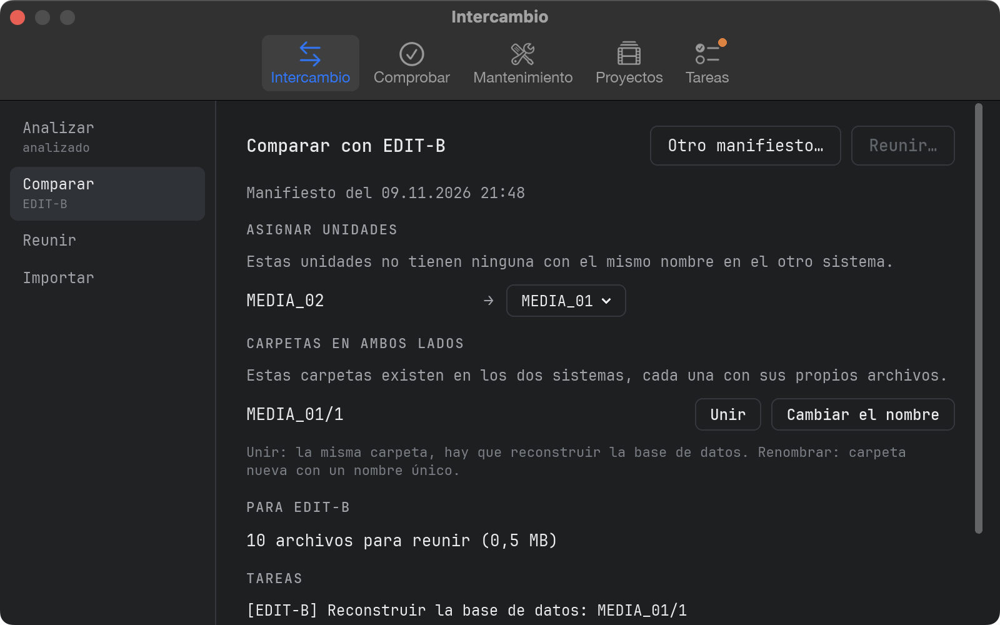
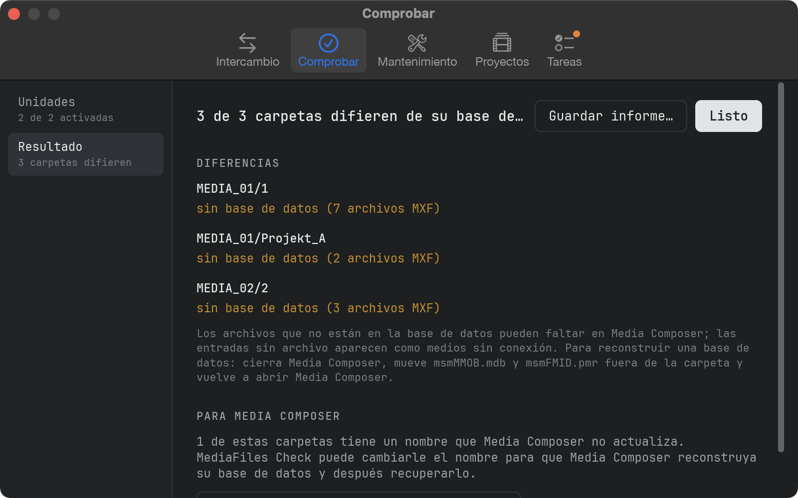
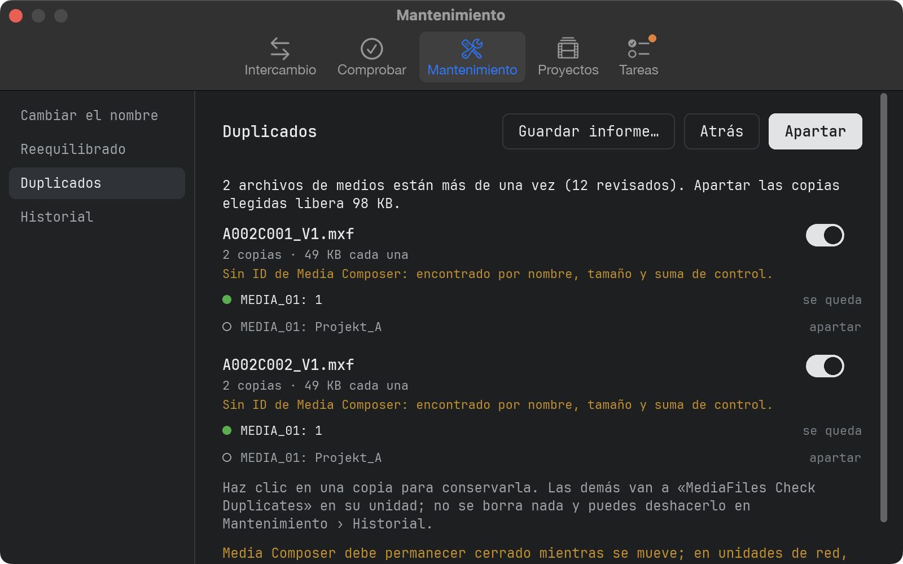
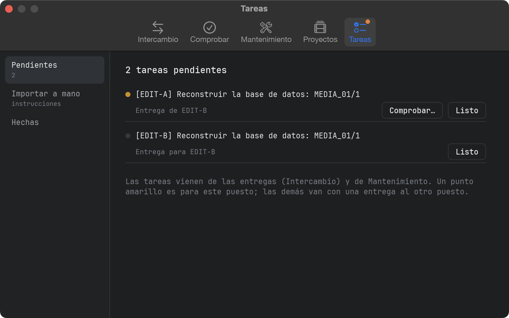

# Manual

## Qué hace MediaFiles Check

MediaFiles Check cuida de los archivos de medios de Avid (MXF) de tus puestos de edición:

- **Intercambio** mantiene al día los medios de dos puestos, aunque no estén conectados (antes MediaFiles Ferry).
- **Comprobar** compara cada carpeta de `Avid MediaFiles/MXF` con su base de datos de Avid y muestra dónde no coinciden.
- **Mantenimiento** reúne las herramientas que cambian algo: renombrar carpetas para Media Composer, reequilibrado, duplicados y su historial.
- **Proyectos** encuentra los archivos de medios que necesitan los bins de tus proyectos de Avid y que no están en ninguna unidad, y los solicita.
- **Tareas** recoge todo lo que hay que hacer a mano.

MediaFiles Check **nunca borra** un archivo de medios y **nunca sobrescribe** ninguno. Comprobar solo lee.

## La ventana

Las pestañas de arriba son las áreas. Dentro de cada pestaña, la barra lateral de la izquierda muestra sus pasos en el orden en que se hacen; bajo cada paso, una línea corta indica cómo está. Un pequeño punto naranja en una pestaña indica que algo espera allí.

## Qué se espera

En cada unidad, también en unidades de red:

- `Avid MediaFiles/MXF/<carpeta>/` con los archivos de medios `.mxf`
- los dos archivos de base de datos de Avid `msmFMID.pmr` y `msmMMOB.mdb` en cada carpeta
- las carpetas `Creating` y los archivos ocultos se ignoran

Las carpetas pueden llamarse como sea, p. ej. `1`, `Avid8.1` o `Mac Studio.1`. Cada unidad conectada con `Avid MediaFiles/MXF` tiene un interruptor; los mismos interruptores valen para Intercambio › Analizar y Comprobar › Unidades, y se recuerdan. Las unidades nuevas quedan activadas.

## Intercambio: analizar

Intercambio › **Analizar** registra cada archivo MXF de las unidades activadas con una suma de comprobación y escribe un pequeño *manifiesto*: una lista de archivos, sin medios.

- El primer análisis tarda, porque cada archivo se lee una vez. Los siguientes solo leen archivos nuevos o modificados.
- Si la app se cierra durante un análisis, no se pierde nada: el siguiente continúa.

**Guardar manifiesto…** lo guarda p. ej. como `261101-1312_Mac Studio_Manifest.ferry`. Envíalo al otro puesto, p. ej. por correo o memoria USB.

## Intercambio: comparar y reunir

1. Analiza primero este puesto para que tu manifiesto esté al día.
2. Intercambio › **Comparar** → **Abrir manifiesto…** y elige el manifiesto del otro puesto, o una solicitud guardada en Proyectos › Solicitar.
3. **Asignar unidades:** las unidades sin una del mismo nombre en el otro lado necesitan un destino, o **No enviar**. La elección se recuerda.
4. **Carpetas en ambos lados:** elige **Unir** o **Renombrar** para cada carpeta (ver abajo).
5. Revisa el número de archivos y las tareas; luego haz clic en **Reunir…** y elige dónde crear la carpeta de entrega.

Cada archivo se copia con control de suma en una carpeta nueva como `261102-1830_Mac Studio_to_MacBook`, junto con `Tasks.txt` (instrucciones para importar a mano). Reunir de nuevo tras una interrupción continúa donde se quedó.

## Intercambio: importar

1. Cierra Media Composer.
2. Intercambio › **Importar** → **Elegir entrega…**.
3. Cada unidad de la entrega necesita una unidad en este puesto; las del mismo nombre se asignan solas.
4. **Verificar e importar** verifica primero cada archivo. Solo se importa una entrega completa y sin daños: los archivos solo se añaden, nunca se sobrescribe un archivo de medios. Las bases de datos reemplazadas se guardan en `Avid MediaFiles/Ferry-Backup/`.
5. Después vuelve a analizar para que el manifiesto esté al día.

## ¿Cuándo se copia algo?

Un archivo cuenta como **presente** si existe en algún lugar del otro puesto con el mismo nombre y la misma suma de comprobación.

- **Carpeta idéntica en ambos lados:** no pasa nada.
- **Carpeta ausente en el otro lado:** se copia la carpeta entera, con su base de datos.
- **Un lado tiene archivos de más:** se copian los archivos y la base de datos del lado más completo.
- **Ambos lados tienen archivos propios:** solo se copian los archivos; tarea «Reconstruir la base de datos».
- **Mismo nombre de archivo, contenido distinto:** no se copia; una tarea pide comprobarlo.

Una base de datos solo se entrega si la carpeta de destino queda exactamente como la de origen; nunca se borra una base de datos. Carpetas como `1` existen en cada puesto: **Unir** pone los archivos en la misma carpeta (hay que reconstruir la base de datos), **Renombrar** en una carpeta nueva como `261031_MacStudio_1`.

## Comprobar unidades

Comprobar › **Unidades** muestra cada unidad conectada; el punto verde indica que está lista. Activa las unidades que quieras comprobar y haz clic en **Comprobar**. **Comprobar carpeta…** comprueba un lugar que elijas: una unidad, la carpeta `MXF`, una sola carpeta como `MXF/1` o una copia en una unidad de respaldo.

## El resultado

Comprobar › **Resultado** muestra cada carpeta que difiere:

- **Archivos que no están en la base de datos**: puede que Media Composer no los muestre.
- **Entradas de la base de datos sin archivo**: aparecen como medios sin conexión.
- **Sin base de datos** / **falta msmFMID.pmr o msmMMOB.mdb** / **base de datos vacía**.
- **Base de datos ilegible**: un formato desconocido. MediaFiles Check nunca adivina.

Se muestran hasta 10 nombres de archivo por hallazgo; **Guardar informe…** los escribe todos en un archivo de texto. Las carpetas que Media Composer no actualiza por sí mismo tienen ahí mismo **Cambiar el nombre para Media Composer…**.

## Renombrar para Media Composer

Media Composer solo reconstruye las bases de datos de sus propias carpetas: carpetas numeradas como `1` en unidades locales, `<nombre del equipo>.<número>` en unidades de red. Las demás carpetas, p. ej. copiadas de otro puesto, conservan su base de datos antigua. Mantenimiento › **Renombrar** muestra el proceso arriba: Renombrar — Media Composer escribe — Recuperar el nombre.

1. Cierra Media Composer y renombra las carpetas (desde Comprobar › Resultado, o al reequilibrar o apartar duplicados). Cada una recibe el siguiente número libre; se recuerdan el nombre original y cada archivo de medios.
2. **Abrir Media Composer** y espera a que haya leído las unidades. El punto de una carpeta se pone verde cuando Media Composer ha escrito su base de datos.
3. Cierra Media Composer y haz clic en **Recuperar el nombre**.

Antes de recuperar el nombre se comprueba cada carpeta: **archivos nuevos** (normalmente grabados mientras la carpeta tenía el nombre nuevo: moverlos a una carpeta nueva, a la carpeta `1` o dejarlos), **archivos que faltan o han cambiado**, **base de datos aún no reescrita**. **Dejarla así por ahora** la deja como está.

Los nombres originales se guardan antes de renombrar nada, así sobreviven a un fallo o a un reinicio. Una carpeta se reconoce por su unidad, su nombre actual y sus archivos de medios; una unidad que vuelve con otro nombre se encuentra de nuevo. Una carpeta renombrada que se borró o se movió a mano desaparece de la lista.

## Reequilibrado

Recomendamos no más de 5000 archivos por carpeta MXF. El límite (Ajustes → Reequilibrado) cuenta cada archivo de una carpeta, incluidos los dos archivos de base de datos.

Una carpeta y sus carpetas reequilibradas (`<nombre>-rebalanced-1`, `-2` …) van juntas. El reequilibrado reparte todo el grupo: los archivos de medios más antiguos van a `-rebalanced-1`, los siguientes a `-2` …, los más recientes se quedan en la carpeta principal. Mantenimiento › **Reequilibrado** → **Buscar carpetas llenas…** muestra cada grupo de las unidades activadas que no cumple el límite.

1. Cierra Media Composer (en unidades de red, en cada puesto) y elige los grupos.
2. Haz clic en **Reequilibrar**. Para una carpeta que crea Media Composer (`1`, `<nombre del equipo>.1`) recomendamos darle antes un nombre propio. No se copia ni se borra nada; una carpeta reequilibrada sin archivos de medios va entera a `MediaFiles Check Database Backups`.
3. Después hay que reescribir las bases de datos de las carpetas modificadas. **Iniciar** pone sus archivos de base de datos en `MediaFiles Check Database Backups` en la misma unidad y renombra las carpetas que Media Composer no actualiza por sí mismo; sigue en Mantenimiento › Renombrar. **Cancelar** deja las bases de datos como están; queda en Tareas e Historial.

Cada cambio del límite pregunta antes; la siguiente **Buscar carpetas llenas…** vuelve a repartir cada grupo.

## Duplicados

Mantenimiento › **Duplicados** → **Buscar duplicados…** busca en las unidades activadas archivos de medios que están más de una vez, por su ID de Media Composer, así que también encuentra copias renombradas; los archivos sin ID, por nombre, tamaño y suma de comprobación. Los espacios de trabajo de Mountpoint se dejan fuera.

El punto verde marca la copia que se queda (la que conoce la base de datos de su carpeta; si no, la más antigua); haz clic en otra copia para quedarte con ella. Las copias con el mismo ID pero distinto tamaño no se activan solas. **Apartar** mueve las demás copias a `MediaFiles Check Duplicates` en su unidad; una carpeta que se queda sin archivos de medios va con ellas. Después se reescriben las bases de datos como en el reequilibrado.

## Historial

Mantenimiento › **Historial** muestra cada operación de reequilibrado y de duplicados: **Reescribir bases de datos** hace el paso de las bases más tarde, **Deshacer** lo devuelve todo (nunca sobre un archivo existente); recupera antes el nombre de las carpetas renombradas.

## Proyectos

1. Proyectos › **Elegir proyectos** → **Elegir carpeta…**: la carpeta con tus proyectos de Avid (cada carpeta con un archivo `.avp`; `Attic` se deja fuera). Se recuerda. Activa los proyectos que quieras comprobar y haz clic en **Analizar**.
2. **Medios que faltan** muestra por bin cada archivo de medios que falta una vez, con el nombre de su master clip. Un clic muestra dónde se usa. **Guardar lista…** escribe la lista entera.
3. **Clips AMA** muestra dónde se usan los archivos vinculados por AMA. No se solicitan.
4. **Solicitar** → **Guardar solicitud…** escribe un archivo `…_Request.ferry`. Envíalo al puesto que tiene los medios; allí: Intercambio › Comparar, ábrelo y luego Reunir. Aquí: Intercambio › Importar la entrega.

Conviene saber:

- Los clips se relacionan con sus medios por los ID de medios de Avid, no por los nombres de archivo. Un archivo que no está en ninguna base de Avid se reconoce por el ID de su cabecera MXF.
- Un archivo que falta cuya fuente está en las unidades en otro archivo de medios se marca **en las unidades: volver a vincular**: vuelve a vincularlo en Media Composer. No se solicita.
- Los archivos sin referencia de medios de Avid (p. ej. importados por AAF) se cuentan aparte; el intercambio solo los encuentra si el otro puesto los tiene en Avid MediaFiles.
- Las pistas de sonido de cámara que nunca tuvieron archivo de medios y los archivos de render que faltan solo se cuentan.
- Una unidad que no responde durante 30 segundos se omite y se nombra en el resultado.

## Tareas

Tareas › **Pendientes** muestra todo lo que hay que hacer a mano: tareas de entregas reunidas o importadas aquí (el puesto al que corresponden va entre corchetes; un punto amarillo significa este puesto), bases de datos que aún hay que reescribir tras un reequilibrado o duplicados, y carpetas que esperan recuperar su nombre. Donde la app puede ayudar, el botón está al lado, p. ej. **Comprobar…** para una carpeta de este puesto que necesita una base de datos nueva. **Listo** pasa una tarea a **Hechas**.

**Importar a mano** explica cómo importar una entrega sin la app. La regla más importante: copia solo el contenido de la carpeta de entrega; nunca arrastres la carpeta entera sobre una existente, el Finder la reemplazaría con todos sus archivos de medios.

## Reconstruir una base de datos

1. Cierra Media Composer.
2. Saca `msmMMOB.mdb` y `msmFMID.pmr` de la carpeta, p. ej. a una carpeta del escritorio. No los borres hasta que todo vuelva a funcionar.
3. Abre Media Composer. Escribe una base de datos nueva para la carpeta.
4. Vuelve a comprobar la carpeta.

Para las carpetas que Media Composer no actualiza por sí mismo, usa en su lugar Mantenimiento › Renombrar.

## Ajustes

**MediaFiles Check → Ajustes…** (⌘,) abre la ventana de ajustes: **General** (Claro/Oscuro, idioma), **Reequilibrado** (archivos por carpeta), **Actualizaciones**, **Soporte** y **Acerca de**.

## Actualizaciones

MediaFiles Check busca una versión nueva en GitHub poco después de abrirse y cada 6 horas; **Ajustes… → Actualizaciones → Buscar actualizaciones** busca enseguida. Una versión nueva aparece como una barra bajo las pestañas: **Novedades** abre las notas de la versión, **Instalar actualización** la descarga, comprueba que está completa y sin cambios, lleva la versión antigua a la Papelera y reinicia la app. **Recibir versiones de prueba** ofrece también versiones que aún se están probando.

## Soporte

**Ajustes… → Soporte**:

- **Autoprueba…** comprueba la lectura de bases de datos, la comparación, el renombrado y las actualizaciones con sus propios datos de prueba. **Enviar informe** manda el resultado de forma anónima; **Guardar** lo deja en Descargas.
- **Informar…** nos envía un problema o una idea, sin cuenta de GitHub.
- **Ver registro** (ver abajo).
- **Invítame a un café**: si usas MediaFiles Check y te gusta, me alegrará un café.

Si el envío falla, el informe se guarda en Descargas.

## Archivo de registro

MediaFiles Check anota lo que hace (comprobaciones, análisis, entregas, renombrados, errores) en un archivo de registro. **Ayuda → Mostrar archivo de registro** lo muestra en el Finder; adjúntalo cuando informes de un problema.
