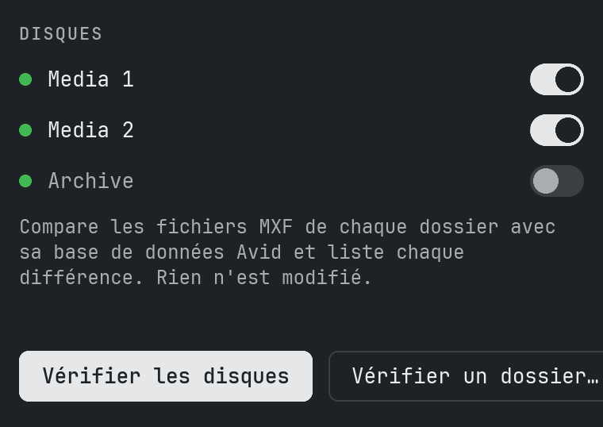
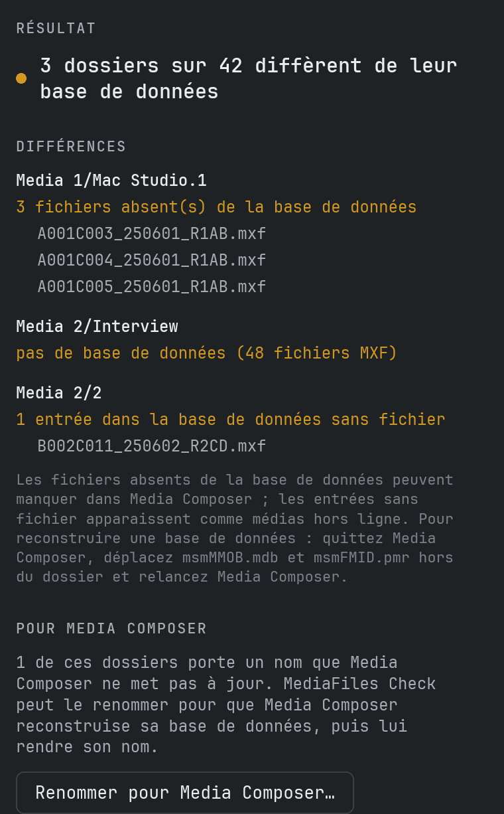
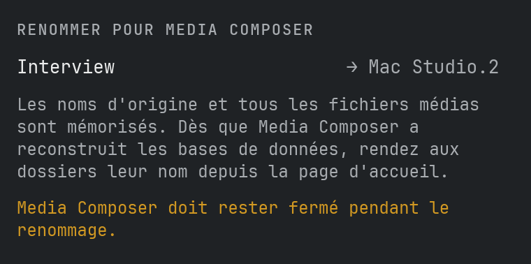
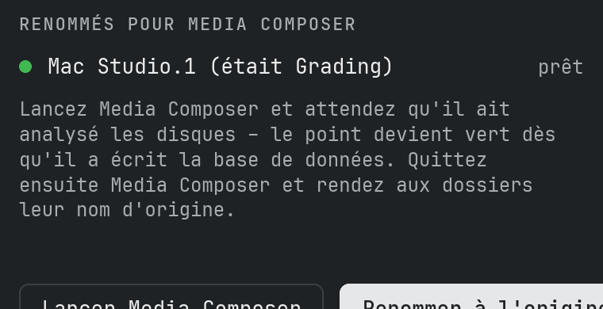
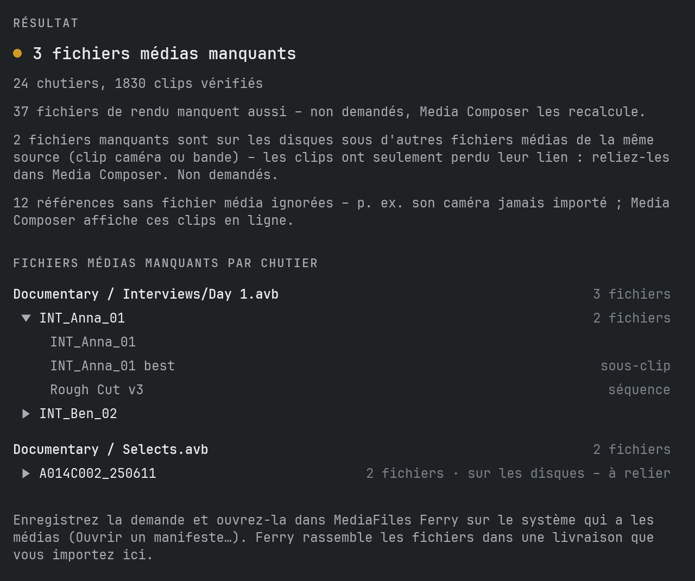

# Manuel

## Ce que fait MediaFiles Check

MediaFiles Check compare chaque dossier de `Avid MediaFiles/MXF` avec sa base de données Avid et montre où les deux ne correspondent pas. C'est utile quand des médias manquent dans Media Composer, apparaissent hors ligne, ou après avoir copié ou déplacé des fichiers à la main.

La vérification **ne fait que lire**. Seulement si vous le demandez, MediaFiles Check renomme des dossiers pour Media Composer (voir plus bas) – il ne supprime ni n'écrase jamais un fichier ou une base de données.

## Ce qu'il attend

Sur chaque disque, y compris les disques réseau :

- `Avid MediaFiles/MXF/<dossier>/` avec les fichiers médias `.mxf`
- les deux fichiers de base de données Avid `msmFMID.pmr` et `msmMMOB.mdb` dans chaque dossier
- les dossiers `Creating` et les fichiers cachés sont ignorés

Les noms de dossier sont libres, p. ex. `1`, `Avid8.1` ou `Mac Studio.1`.

## Vérifier les disques

La page d'accueil montre chaque disque connecté avec `Avid MediaFiles/MXF` – le point vert signifie que le disque est prêt. La liste se met à jour toute seule quand vous connectez ou éjectez un disque.

1. Activez les disques à vérifier. Les nouveaux disques sont activés automatiquement.
2. Cliquez sur **Vérifier les disques**.

## Vérifier un dossier

**Vérifier un dossier…** vérifie un emplacement de votre choix :

- un disque – tous ses dossiers MXF
- le dossier `MXF` lui-même
- un seul dossier de médias comme `MXF/1`
- n'importe quel dossier contenant des dossiers MXF, p. ex. une copie sur un disque de sauvegarde

## Le résultat

Le résultat liste chaque dossier qui diffère, avec ce qui a été trouvé :

- **Fichiers absents de la base de données** – le dossier contient des fichiers MXF que la base de données ne connaît pas. Media Composer ne les affiche peut-être pas.
- **Entrées de la base de données sans fichier** – la base de données liste des fichiers absents du dossier. Ils apparaissent comme médias hors ligne.
- **Pas de base de données** – le dossier a des fichiers MXF mais aucun fichier de base de données.
- **msmFMID.pmr ou msmMMOB.mdb manque** – l'un des deux fichiers de base de données a disparu.
- **Base de données vide** – `msmFMID.pmr` n'a aucun contenu.
- **Base de données illisible** – le fichier n'a pas pu être lu ou a un format que MediaFiles Check ne connaît pas. Il ne devine jamais.

Jusqu'à 10 noms de fichiers sont affichés par constat. **Enregistrer le rapport…** écrit toutes les différences avec chaque nom de fichier dans un fichier texte.

## Renommer pour Media Composer

Media Composer ne reconstruit que les bases de données de ses propres dossiers : des dossiers numérotés comme `1` ou `2` sur les disques locaux, `<nom de l'ordinateur>.<numéro>` (p. ex. `Mac Studio.3`) sur les disques réseau. Les dossiers portant d'autres noms – p. ex. copiés depuis un autre système – gardent leur ancienne base de données.

Après une vérification, **Renommer pour Media Composer…** propose de renommer ces dossiers :

1. Quittez Media Composer et cliquez sur **Renommer**. Chaque dossier reçoit le prochain numéro libre (ou nom de l'ordinateur et numéro). MediaFiles Check retient le nom d'origine et chaque fichier média.
2. Cliquez sur **Lancer Media Composer** (ou lancez-le vous-même) et attendez qu'il ait analysé les disques. Sur la page d'accueil, le point d'un dossier devient vert dès que Media Composer a écrit sa base de données.
3. Quittez Media Composer et cliquez sur **Renommer à l'origine**.

Avant de rendre son nom d'origine, MediaFiles Check vérifie chaque dossier :

- **Nouveaux fichiers** – en général des médias que Media Composer a enregistrés dans le dossier pendant qu'il portait le nouveau nom. Au choix : les déplacer dans un nouveau dossier numéroté, les déplacer dans le dossier `1` (ou `<nom de l'ordinateur>.1`), ou les laisser dans le dossier.
- **Fichiers manquants ou modifiés** – vous décidez si le dossier reprend quand même son nom.
- **Base de données pas encore réécrite** – vous décidez si le dossier reprend quand même son nom.

**Le laisser renommé pour l'instant** laisse le dossier tel quel ; vous pourrez le renommer plus tard. Si un dossier portant le nom d'origine existe entre-temps, rien n'est renommé et vous en êtes informé.

Les noms d'origine sont enregistrés avant tout renommage : ils résistent à un plantage, à la fermeture de l'app ou à un redémarrage, et les dossiers renommés réapparaissent sur la page d'accueil au lancement suivant. Un dossier est reconnu à son disque, son nom actuel et ses fichiers média – un disque qui revient sous un autre nom (p. ex. `Media 1`) est retrouvé grâce à ses fichiers média.

## Projets Avid

**Ouvrir les projets…** sur la page d'accueil ouvre la fenêtre des projets Avid. Elle trouve les fichiers médias dont les chutiers de vos projets ont besoin et qui ne sont sur aucun disque connecté – et écrit une demande pour MediaFiles Ferry, qui les rassemble sur le système qui les possède.

1. **Choisir un dossier…** – le dossier de vos projets Avid. Chaque dossier contenant un fichier `.avp` compte comme projet (les sauvegardes dans `Attic` sont ignorées). Le dossier est mémorisé.
2. Activez les projets à vérifier – au départ, tous sont désactivés.
3. Cliquez sur **Analyser**. MediaFiles Check lit chaque chutier et suit chaque master clip, sous-clip et séquence jusqu'aux fichiers médias qu'ils utilisent, y compris d'un chutier à l'autre du projet. Il les compare aux bases de données Avid de tous les disques connectés.
4. Le résultat liste, par chutier, chaque fichier média manquant une seule fois – nommé d'après son master clip, « 3 fichiers » quand p. ex. l'image et le son d'un clip manquent. Cliquez sur un fichier pour voir où il est utilisé dans le chutier (master clip, sous-clips, séquences). **Enregistrer la liste…** écrit toute la liste dans un fichier texte.
5. **Enregistrer la demande…** écrit un fichier `…_Request.ferry`. Ouvrez-le dans MediaFiles Ferry sur le système qui a les médias (**Ouvrir un manifeste…**) ; Ferry rassemble les fichiers dans une livraison normale, que vous importez ici avec **Vérifier et importer**.

Bon à savoir :

- Clips et médias sont associés par les identifiants médias d'Avid, pas par les noms de fichiers. Un fichier présent sur un disque mais dans **aucune** base de données Avid est identifié par l'identifiant média de son en-tête MXF ; seuls les fichiers à l'en-tête illisible (endommagés, en cours d'écriture) restent non reconnus – le résultat vous en avertit.
- Les fichiers liés par AMA ne sont pas demandés. **Afficher les clips AMA…** ouvre une fenêtre qui montre où ils sont utilisés – comme les médias manquants, un clic sur un clip affiche ses utilisations. Les clips AMA qui ont un clip master du même nom avec ses médias sur les disques (p. ex. liés puis importés) sont ignorés et seulement comptés. La liste enregistrée les contient aussi.
- Un fichier manquant dont la source (clip caméra ou bande, image ou son) est sur les disques sous un autre fichier média est marqué **sur les disques – à relier** : le clip a seulement perdu son lien ; reliez-le dans Media Composer. Il n'est pas demandé.
- Les fichiers sans référence média Avid (p. ex. importés par AAF) sont comptés à part. Ferry ne les trouve que si l'autre système les a dans Avid MediaFiles.
- Les clips master de la caméra ont souvent des pistes son pour lesquelles aucun fichier média n'a jamais été créé (le son a été enregistré à part). Ces références sont ignorées et seulement comptées ; un sous-clip n'a besoin que des pistes qu'il utilise vraiment.
- Les fichiers de rendu manquants (effets calculés) sont seulement comptés, ni listés ni demandés – Media Composer les recalcule.
- Un disque qui ne répond pas pendant 30 secondes est ignoré et nommé dans le résultat.

## Rééquilibrage

Nous recommandons 5000 fichiers au maximum par dossier MXF. La limite (Réglages → Rééquilibrage, 5000 par défaut) compte chaque fichier d'un dossier, les deux fichiers de base de données compris : un dossier reçoit donc au plus la limite moins 2 fichiers média.

Un dossier et ses dossiers rééquilibrés (`<nom>-rebalanced-1`, `-2`…) vont ensemble ; la terminaison `.1` de Media Composer est retirée du nom (`Mac Studio.1` → `Mac Studio-rebalanced-1`, `1` → `1-rebalanced-1`). Le rééquilibrage répartit toujours tout le groupe : tous ses fichiers média triés par date de création, les plus anciens vont dans `-rebalanced-1`, les suivants dans `-2`…, les plus récents restent dans le dossier principal. **Chercher les dossiers pleins…** sur la page d'accueil liste chaque groupe des disques choisis qui ne respecte pas la limite et montre ce qui serait déplacé.

1. Quittez Media Composer – sur les disques réseau, sur chaque poste – et choisissez les groupes.
2. Cliquez sur **Rééquilibrer**. Pour un dossier que Media Composer crée lui-même (`1`, ou `<nom de l'ordinateur>.1` sur les disques réseau), la question vous est d'abord posée : nous recommandons de lui donner un nom propre. Le dossier est renommé, ses dossiers rééquilibrés prennent le nouveau nom, et Media Composer crée un nouveau dossier pour les nouveaux médias. **Garder le nom** continue sans renommer. Rien n'est copié ni supprimé ; un dossier rééquilibré sans fichiers média (seulement ses fichiers de base de données et le dossier « Creating ») part en entier dans `MediaFiles Check Database Backups`.
3. Ensuite, les bases de données de tous les dossiers modifiés doivent être réécrites. **Lancer** range leurs fichiers de base dans `MediaFiles Check Database Backups` sur le même disque (Media Composer en écrit de nouveaux) et renomme les dossiers que Media Composer ne met pas à jour lui-même. Continuez ensuite comme dans « Renommer pour Media Composer » : lancez Media Composer, attendez les points verts, quittez-le, renommez à l'inverse. **Annuler** laisse les bases de données telles quelles.

**Changer la limite :** MediaFiles Check avertit avant chaque changement. La prochaine recherche **Chercher les dossiers pleins…** répartit chaque groupe selon la nouvelle limite – une limite plus basse répartit les fichiers sur plus de dossiers, une plus haute les ramène. Avec beaucoup de fichiers, cela prend du temps.

**Historique…** sur la page d'accueil liste chaque groupe : **Réécrire les bases** fait l'étape 3 plus tard (aussi après « Annuler » ou si l'app a été quittée entre-temps), **Annuler** ramène tous les fichiers média dans le dossier principal, retire les dossiers rééquilibrés et rend son ancien nom à un dossier renommé – renommez d'abord à l'inverse les dossiers renommés. Une opération interrompue en cours de route est terminée par la prochaine recherche **Chercher les dossiers pleins…**.

## Doublons

**Chercher les doublons…** sur la page d'accueil parcourt les disques choisis à la recherche de fichiers média présents plusieurs fois. Un fichier média est reconnu à son ID Media Composer (dans le fichier lui-même ou dans la base de son dossier) : les copies renommées sont donc trouvées aussi. Les fichiers sans ID sont comparés par nom, taille et somme de contrôle de leur contenu. Les espaces Mountpoint sont ignorés – ils montrent les fichiers d'un autre disque.

La liste montre chaque fichier média avec ses copies : le point vert marque la copie qui reste (celle que connaît la base de son dossier, sinon la plus ancienne) – cliquez sur une autre copie pour garder celle-ci. Désactivez ce qui doit rester tel quel (p. ex. un disque de sauvegarde). Les copies de même ID mais de tailles différentes ne sont pas activées d'office – vérifiez-les d'abord. **Enregistrer le rapport…** écrit toute la liste dans un fichier texte.

**Mettre de côté** (Media Composer fermé – sur les disques réseau, sur chaque poste) déplace les autres copies dans `MediaFiles Check Duplicates` sur leur propre disque ; rien n'est copié ni supprimé. Un dossier qui n'a plus de fichiers média y part aussi, avec ses fichiers de base de données et son dossier « Creating » ; **Annuler** le remet en place. Ensuite, les bases de données de leurs dossiers doivent être réécrites : **Lancer** fonctionne comme pour le rééquilibrage, **Annuler** les laisse telles quelles. Supprimez vous-même les copies mises de côté quand tout fonctionne. **Historique…** liste chaque opération avec **Réécrire les bases** et **Annuler** (remet les copies en place, jamais par-dessus un fichier existant).

## Reconstruire une base de données

1. Quittez Media Composer.
2. Déplacez `msmMMOB.mdb` et `msmFMID.pmr` hors du dossier, p. ex. dans un dossier sur le bureau. Ne les supprimez pas avant que tout fonctionne de nouveau.
3. Lancez Media Composer. Il écrit une nouvelle base de données pour le dossier.
4. Vérifiez à nouveau le dossier.

## Réglages

**MediaFiles Check → Réglages…** (⌘,) ouvre la fenêtre des réglages avec trois onglets : **Général** règle l'apparence (interrupteur **Clair/Sombre**, activé = sombre) et la langue (English, Deutsch, Français, Español), **Mises à jour** et **Assistance** sont décrits plus bas, **À propos** affiche la version et la licence. **MediaFiles Check → À propos de MediaFiles Check** ouvre la même fenêtre sur l'onglet À propos ; Réglages… ouvre le dernier onglet utilisé.

## Mises à jour

MediaFiles Check recherche une nouvelle version sur GitHub peu après le démarrage puis toutes les 6 heures ; **Réglages… → Mises à jour → Rechercher des mises à jour** le fait immédiatement. Une nouvelle version s'affiche en haut de la fenêtre principale : **Nouveautés** ouvre les notes de version, **Installer la mise à jour** la télécharge, vérifie qu'elle est complète et intacte, met l'ancienne version à la corbeille et redémarre l'app. **Recevoir les versions de test** (Réglages… → Mises à jour) propose aussi des versions encore en test – réservé aux testeurs ; tant qu'une version de test tourne, les versions de test plus récentes sont toujours proposées.

## Assistance

**Réglages… → Assistance** propose quatre choses :

- **Autotest…** vérifie la lecture des bases de données, la comparaison, le renommage pour Media Composer et le retour, ainsi que les mises à jour – sur ses propres données de test dans un dossier temporaire. Vos disques sont seulement listés, jamais modifiés. **Envoyer** nous envoie le résultat de façon anonyme ; **Enregistrer** le place dans Téléchargements pour que vous puissiez le consulter d’abord.
- **Signaler…** nous envoie un problème ou une idée – sans compte GitHub. Vous pouvez indiquer votre e-mail pour des questions et joindre les infos système et le fichier journal ; votre nom d’utilisateur et les noms de dossiers sont remplacés.
- **Afficher le journal** (voir ci-dessous).
- **Offrez-moi un café** – si vous utilisez MediaFiles Check et qu’il vous plaît, un café me ferait plaisir.

Si l’envoi échoue, le rapport est enregistré dans Téléchargements.

## Fichier journal

MediaFiles Check note ce qu'il fait – vérifications, renommages, erreurs – dans un fichier journal. **Aide → Afficher le fichier journal** le montre dans le Finder ; joignez-le quand vous signalez un problème.
