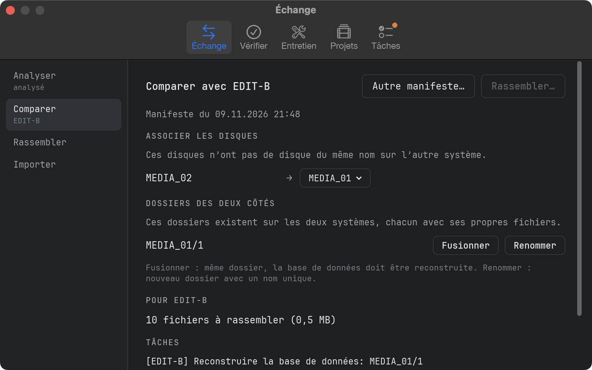
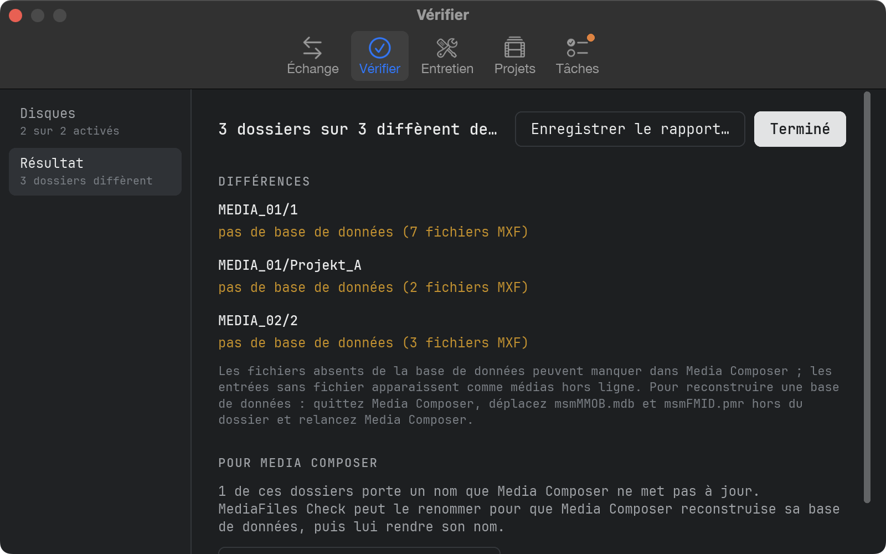
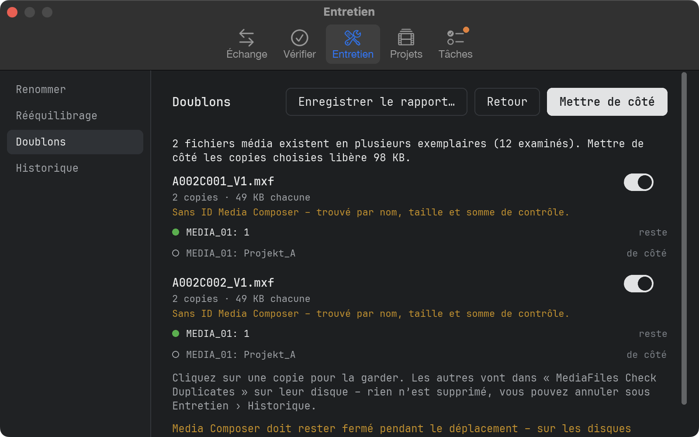
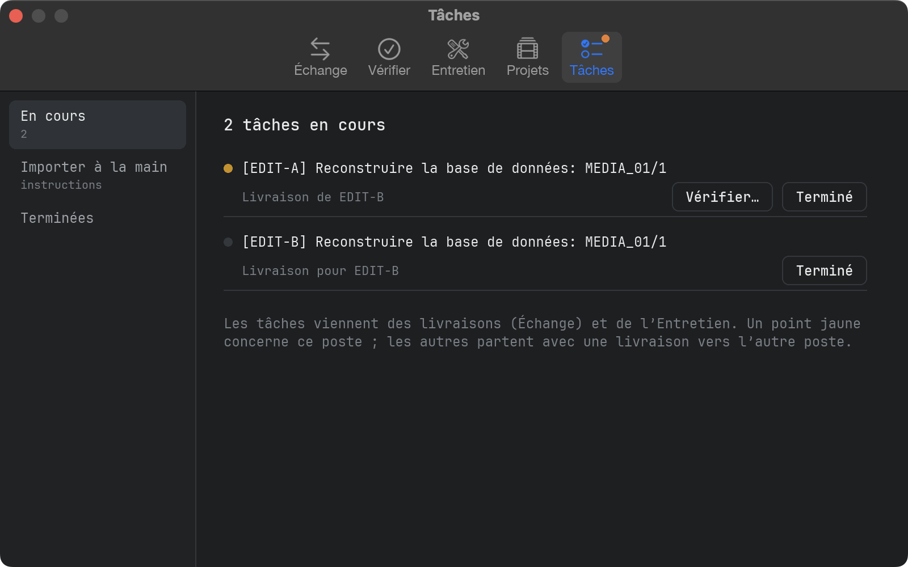
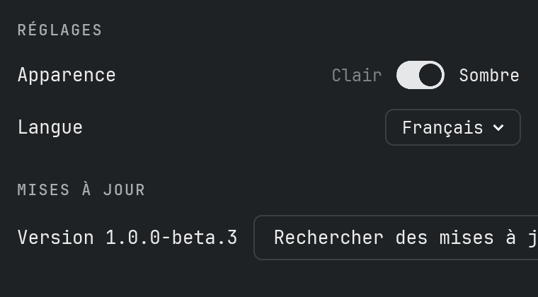

# Manuel

## Ce que fait MediaFiles Check

MediaFiles Check prend soin des fichiers média Avid (MXF) de vos postes de montage :

- **Échange** synchronise les médias de deux postes, même s’ils ne sont pas connectés (anciennement MediaFiles Ferry).
- **Vérifier** compare chaque dossier de `Avid MediaFiles/MXF` à sa base de données Avid et montre où les deux ne concordent pas.
- **Entretien** regroupe les outils qui modifient quelque chose : renommer des dossiers pour Media Composer, rééquilibrage, doublons et leur historique.
- **Projets** trouve les fichiers média dont les chutiers de vos projets Avid ont besoin et qui ne sont sur aucun disque, et les demande.
- **Tâches** réunit tout ce qu’il faut faire à la main.

MediaFiles Check **ne supprime jamais** un fichier média et **n’en écrase jamais**. Vérifier ne fait que lire.

## La fenêtre

Les onglets en haut sont les domaines. Dans chaque onglet, la barre latérale à gauche liste ses étapes dans l’ordre où on les fait ; sous chaque étape, une courte ligne indique où elle en est. Un petit point orange sur un onglet signale que quelque chose y attend.

## Ce qui est attendu

Sur chaque disque, y compris les disques réseau :

- `Avid MediaFiles/MXF/<dossier>/` avec les fichiers média `.mxf`
- les deux fichiers de base de données Avid `msmFMID.pmr` et `msmMMOB.mdb` dans chaque dossier
- les dossiers `Creating` et les fichiers cachés sont ignorés

Les dossiers peuvent porter n’importe quel nom, p. ex. `1`, `Avid8.1` ou `Mac Studio.1`. Chaque disque connecté avec `Avid MediaFiles/MXF` a un interrupteur ; les mêmes interrupteurs valent pour Échange › Analyser et Vérifier › Disques, et ils sont mémorisés. Les nouveaux disques sont activés.

## Échange : analyser

Échange › **Analyser** enregistre chaque fichier MXF des disques activés avec une somme de contrôle et écrit un petit *manifeste* – une liste de fichiers, sans médias.

- La première analyse prend du temps, car chaque fichier est lu une fois. Les suivantes ne lisent que les fichiers nouveaux ou modifiés.
- Si l’app est fermée pendant une analyse, rien n’est perdu – la suivante reprend.

**Enregistrer le manifeste…** l’enregistre p. ex. sous `261101-1312_Mac Studio_Manifest.ferry`. Envoyez-le à l’autre poste, p. ex. par e-mail ou clé USB.

## Échange : comparer et rassembler

1. Analysez d’abord ce poste, pour que votre manifeste soit à jour.
2. Échange › **Comparer** → **Ouvrir un manifeste…** et choisissez le manifeste de l’autre poste – ou une demande enregistrée sous Projets › Demander.
3. **Associer les disques :** les disques sans disque du même nom de l’autre côté ont besoin d’une cible – ou de **Ne pas envoyer**. Le choix est mémorisé.
4. **Dossiers des deux côtés :** choisissez **Fusionner** ou **Renommer** pour chaque dossier (voir plus bas).
5. Vérifiez le nombre de fichiers et les tâches, puis cliquez sur **Rassembler…** et choisissez où créer le dossier de livraison.

Chaque fichier est copié avec contrôle de somme dans un nouveau dossier comme `261102-1830_Mac Studio_to_MacBook`, avec `Tasks.txt` (instructions pour importer à la main). Rassembler à nouveau après une interruption reprend là où cela s’est arrêté.

## Échange : importer

1. Quittez Media Composer.
2. Échange › **Importer** → **Choisir la livraison…**.
3. Chaque disque de la livraison a besoin d’un disque sur ce poste ; les disques du même nom sont associés automatiquement.
4. **Vérifier et importer** vérifie d’abord chaque fichier. Seule une livraison complète et intacte est importée – les fichiers sont seulement ajoutés, un fichier média n’est jamais écrasé. Les bases de données remplacées sont gardées dans `Avid MediaFiles/Ferry-Backup/`.
5. Analysez à nouveau ensuite, pour que le manifeste soit à jour.

## Quand quelque chose est-il copié ?

Un fichier est **présent** s’il existe quelque part sur l’autre poste avec le même nom et la même somme de contrôle.

- **Dossier identique des deux côtés :** rien ne se passe.
- **Dossier absent de l’autre côté :** le dossier entier est copié, avec sa base de données.
- **Un côté a des fichiers en plus :** les fichiers et la base de données du côté le plus complet sont copiés.
- **Les deux côtés ont leurs propres fichiers :** seuls les fichiers sont copiés – tâche « Reconstruire la base de données ».
- **Même nom de fichier, contenu différent :** pas copié – une tâche demande de vérifier.

Une base de données n’est livrée que si le dossier cible devient exactement comme le dossier source ; une base de données n’est jamais supprimée. Des dossiers comme `1` existent sur chaque poste : **Fusionner** met les fichiers dans le même dossier (la base de données doit être reconstruite), **Renommer** dans un nouveau dossier comme `261031_MacStudio_1`.

## Vérifier les disques

Vérifier › **Disques** liste chaque disque connecté – le point vert signifie qu’il est prêt. Activez les disques à vérifier et cliquez sur **Vérifier**. **Vérifier un dossier…** vérifie l’emplacement de votre choix : un disque, le dossier `MXF`, un seul dossier comme `MXF/1`, ou une copie sur un disque de sauvegarde.

## Le résultat

Vérifier › **Résultat** liste chaque dossier qui diffère :

- **Fichiers absents de la base** – Media Composer risque de ne pas les afficher.
- **Entrées de la base sans fichier** – elles apparaissent comme médias hors ligne.
- **Pas de base de données** / **msmFMID.pmr ou msmMMOB.mdb manque** / **Base de données vide**.
- **Base de données illisible** – un format inconnu. MediaFiles Check ne devine jamais.

Jusqu’à 10 noms de fichiers sont affichés par constat ; **Enregistrer le rapport…** les écrit tous dans un fichier texte. Les dossiers que Media Composer ne met pas à jour lui-même ont directement **Renommer pour Media Composer…**.

## Renommer pour Media Composer

Media Composer ne reconstruit que les bases de données de ses propres dossiers : des dossiers numérotés comme `1` sur les disques locaux, `<nom de l’ordinateur>.<numéro>` sur les disques réseau. Les autres dossiers – p. ex. copiés depuis un autre poste – gardent leur ancienne base. Entretien › **Renommer** montre le déroulement en haut : Renommer — Media Composer écrit — Renommer à l’origine.

1. Quittez Media Composer et renommez les dossiers (depuis Vérifier › Résultat, ou lors du rééquilibrage ou de la mise de côté de doublons). Chacun reçoit le prochain numéro libre ; le nom d’origine et chaque fichier média sont mémorisés.
2. **Lancer Media Composer** et attendez qu’il ait lu les disques. Le point d’un dossier devient vert dès que Media Composer a écrit sa base de données.
3. Quittez Media Composer et cliquez sur **Renommer à l’origine**.

Avant de renommer à l’origine, chaque dossier est vérifié : **nouveaux fichiers** (en général enregistrés pendant que le dossier avait le nouveau nom – les déplacer dans un nouveau dossier, dans le dossier `1`, ou les garder), **fichiers manquants ou modifiés**, **base pas encore réécrite**. **Le laisser renommé pour l’instant** le garde tel quel.

Les noms d’origine sont enregistrés avant tout renommage et survivent ainsi à un plantage ou un redémarrage. Un dossier est reconnu par son disque, son nom actuel et ses fichiers média ; un disque qui revient sous un autre nom est retrouvé. Un dossier renommé supprimé ou déplacé à la main disparaît de la liste.

## Rééquilibrage

Nous recommandons au plus 5000 fichiers par dossier MXF. La limite (Réglages → Rééquilibrage) compte chaque fichier d’un dossier, les deux fichiers de base de données compris.

Un dossier et ses dossiers rééquilibrés (`<nom>-rebalanced-1`, `-2` …) vont ensemble. Le rééquilibrage répartit tout le groupe : les fichiers média les plus anciens vont dans `-rebalanced-1`, les suivants dans `-2` …, les plus récents restent dans le dossier principal. Entretien › **Rééquilibrage** → **Chercher les dossiers pleins…** liste chaque groupe des disques activés qui ne respecte pas la limite.

1. Quittez Media Composer – sur les disques réseau, sur chaque poste – et choisissez les groupes.
2. Cliquez sur **Rééquilibrer**. Pour un dossier que Media Composer crée lui-même (`1`, `<nom de l’ordinateur>.1`), nous recommandons de lui donner d’abord un nom propre. Rien n’est copié ni supprimé ; un dossier rééquilibré sans fichiers média part en entier dans `MediaFiles Check Database Backups`.
3. Ensuite, les bases de données des dossiers modifiés doivent être réécrites. **Lancer** met leurs fichiers de base dans `MediaFiles Check Database Backups` sur le même disque et renomme les dossiers que Media Composer ne met pas à jour lui-même ; continuez sous Entretien › Renommer. **Annuler** laisse les bases telles quelles – cela reste dans Tâches et Historique.

Chaque changement de limite demande d’abord confirmation ; la prochaine recherche **Chercher les dossiers pleins…** répartit à nouveau chaque groupe.

## Doublons

Entretien › **Doublons** → **Chercher les doublons…** cherche sur les disques activés les fichiers média présents plusieurs fois – par leur ID Media Composer, donc aussi les copies renommées ; les fichiers sans ID par nom, taille et somme de contrôle. Les espaces de travail Mountpoint sont laissés de côté.

Le point vert marque la copie qui reste (celle que connaît la base de son dossier, sinon la plus ancienne) – cliquez sur une autre copie pour garder celle-ci. Les copies de même ID mais de taille différente ne sont pas activées d’elles-mêmes. **Mettre de côté** déplace les autres copies dans `MediaFiles Check Duplicates` sur leur disque ; un dossier sans fichiers média part avec. Ensuite, les bases de données sont réécrites comme pour le rééquilibrage.

## Historique

Entretien › **Historique** liste chaque opération de rééquilibrage et de doublons : **Réécrire les bases** fait l’étape des bases plus tard, **Annuler** remet tout en place (jamais par-dessus un fichier existant) – renommez d’abord à l’origine les dossiers renommés.

## Projets

1. Projets › **Choisir les projets** → **Choisir un dossier…** : le dossier de vos projets Avid (chaque dossier avec un fichier `.avp` ; `Attic` est laissé de côté). Il est mémorisé. Activez les projets à vérifier et cliquez sur **Analyser**.
2. **Médias manquants** liste par chutier chaque fichier média manquant une fois, nommé d’après son master clip. Un clic montre où il est utilisé. **Enregistrer la liste…** écrit la liste entière.
3. **Clips AMA** montre où sont utilisés les fichiers liés en AMA. Ils ne sont pas demandés.
4. **Demander** → **Enregistrer la demande…** écrit un fichier `…_Request.ferry`. Envoyez-le au poste qui a les médias ; là-bas : Échange › Comparer, ouvrez-le, puis Rassembler. Ici : Échange › Importer la livraison.

Bon à savoir :

- Les clips sont reliés à leurs médias par les ID média d’Avid, pas par les noms de fichiers. Un fichier présent dans aucune base Avid est reconnu par l’ID de son en-tête MXF.
- Un fichier manquant dont la source se trouve sur les disques dans un autre fichier média est marqué **sur les disques – reconnecter** : reconnectez-le dans Media Composer. Il n’est pas demandé.
- Les fichiers sans référence média Avid (p. ex. importés par AAF) sont comptés à part ; l’échange ne les trouve que si l’autre poste les a dans Avid MediaFiles.
- Les pistes son de caméra qui n’ont jamais eu de fichier média et les fichiers de rendu manquants sont seulement comptés.
- Un disque qui ne répond pas pendant 30 secondes est ignoré et nommé dans le résultat.

## Tâches

Tâches › **En cours** liste tout ce qu’il faut faire à la main : les tâches des livraisons rassemblées ou importées ici (le poste concerné est entre crochets ; un point jaune signifie ce poste), les bases à réécrire après un rééquilibrage ou des doublons, et les dossiers qui attendent d’être renommés à l’origine. Là où l’app peut aider, le bouton est juste à côté – p. ex. **Vérifier…** pour un dossier de ce poste qui a besoin d’une nouvelle base. **Terminé** déplace une tâche dans **Terminées**.

**Importer à la main** explique comment importer une livraison sans l’app. La règle la plus importante : copiez seulement le contenu du dossier de livraison – ne glissez jamais le dossier entier sur un dossier existant, le Finder le remplacerait avec tous ses fichiers média.

## Reconstruire une base de données

1. Quittez Media Composer.
2. Sortez `msmMMOB.mdb` et `msmFMID.pmr` du dossier, p. ex. dans un dossier sur le bureau. Ne les supprimez pas avant que tout fonctionne à nouveau.
3. Lancez Media Composer. Il écrit une nouvelle base de données pour le dossier.
4. Vérifiez à nouveau le dossier.

Pour les dossiers que Media Composer ne met pas à jour lui-même, utilisez plutôt Entretien › Renommer.

## Réglages

**MediaFiles Check → Réglages…** (⌘,) ouvre la fenêtre des réglages : **Général** (Clair/Sombre, langue), **Rééquilibrage** (fichiers par dossier), **Mises à jour**, **Assistance** et **À propos**.

## Mises à jour

MediaFiles Check cherche une nouvelle version sur GitHub peu après le démarrage puis toutes les 6 heures ; **Réglages… → Mises à jour → Rechercher des mises à jour** cherche tout de suite. Une nouvelle version s’affiche comme une barre sous les onglets : **Nouveautés** ouvre les notes de version, **Installer la mise à jour** la télécharge, vérifie qu’elle est complète et intacte, met l’ancienne version à la corbeille et redémarre l’app. **Recevoir les versions de test** propose aussi des versions encore en test.

## Assistance

**Réglages… → Assistance** :

- **Autotest…** vérifie la lecture des bases, la comparaison, le renommage et les mises à jour sur ses propres données de test. **Envoyer** transmet le résultat anonymement ; **Enregistrer** le met dans Téléchargements.
- **Signaler…** nous envoie un problème ou une idée – sans compte GitHub.
- **Afficher le journal** (voir plus bas).
- **Offrez-moi un café** – si vous utilisez MediaFiles Check et l’appréciez, un café me ferait plaisir.

Si l’envoi échoue, le rapport est enregistré dans Téléchargements.

## Journal

MediaFiles Check note ce qu’il fait – vérifications, analyses, livraisons, renommages, erreurs – dans un fichier journal. **Aide → Afficher le fichier journal** le montre dans le Finder ; joignez-le quand vous signalez un problème.
